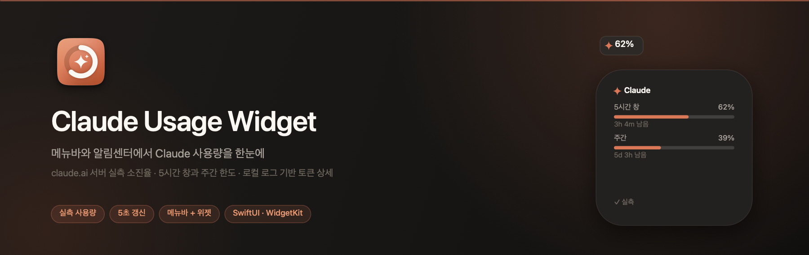

<p align="center">
  
</p>

# Claude Usage Widget

macOS 메뉴바와 알림센터 위젯에서 **Claude 사용량**(5시간 한도 창 / 주간)을 확인하는 프로젝트입니다.

두 개의 데이터 소스를 씁니다:

1. **claude.ai 실측 (기본·권장)** — 앱 안의 로그인 창에서 `claude.ai`에 로그인하면 서버가 계산한 **실제 소진율(%)** 과 정확한 리셋 시각을 가져옵니다. `/usage`가 보여주는 값과 같고, Claude Code·데스크톱·웹을 모두 포함한 **그 계정 전체** 사용량입니다.
2. **로컬 로그 추정 (폴백·상세)** — `~/.claude` 세션 로그를 파싱해 토큰·비용·모델별 분해를 만듭니다. 실측을 못 가져올 때(미로그인·세션 만료)의 대체 표시이자, 서버가 주지 않는 토큰 상세의 출처입니다. 이 로그는 늘 **Claude Code 계정**의 활동이므로, 연동 계정이 다르면 설정에서 경고합니다.

---

## 📋 개요

- **메뉴바 앱** — 5초 간격 로컬 갱신 + 서버 실측 조회(주기 설정 가능, 기본 60초). 아이콘은 **5시간 창 소진율에 따라 채워지는 원형 링**이고, 소진율(%)은 **링 왼쪽**에 숫자로 함께 뜹니다. 기본 «이중 링»은 안쪽 얇은 링으로 **창에서 지난 시간**까지 같이 보여 줘, 남은 시간보다 빨리 태우는 중인지 한눈에 보입니다. 클릭하면 상세 패널이 열립니다 — 제목 옆 **↻** 로 즉시 갱신하고, 오른쪽 위 **⚙︎** 로 설정을 엽니다. 설정의 **메뉴바 표시** 에서 링·막대·게이지·숫자만 등 **여섯 가지 디자인**과 **글자 색**을 고를 수 있고, **주간 소진율**·**리셋까지 남은 시간**을 링 오른쪽에 덧붙일 수 있습니다(둘 다면 위아래 두 줄).
- **알림센터·데스크톱 위젯** — 같은 데이터를 작은/중간 크기 위젯으로 표시합니다. 두 크기 모두 5시간 창과 주간을 함께 보여줍니다.

두 개를 함께 두는 이유는 WidgetKit의 갱신 주기 때문입니다. 위젯 타임라인은 `.after(30초)`를 요청해도 시스템이 그대로 지켜주지 않고 실질 수 분~수십 분 간격으로 깨우며, 하루 갱신 예산도 제한됩니다. **초 단위 실시간은 메뉴바 앱이 담당하고, 위젯은 같은 데이터를 느리게 따라가는 보조 표시**입니다.

---

## 🔓 실측 사용량 — 자체 로그인으로 계정 전체 사용량 불러오기

앱 안의 로그인 창(`WKWebView`)에서 `claude.ai`에 직접 로그인하고, 그 세션으로 서버가 계산한 실제 사용량을 받아옵니다. **Claude 데스크톱 앱이 필요하지 않고, 키체인도 쓰지 않습니다.**

### 세션 확보

```
1. 설정 → 실측 사용량 (claude.ai) → «Claude 로그인»
2. 앱 안의 로그인 창에서 사용자가 직접 로그인 (이메일 코드 / Google SSO)
3. 세션 쿠키가 생기면 창이 자동으로 닫힌다
4. 세션은 WKWebsiteDataStore(persistent)에 남아 앱을 다시 켜도 유지된다 (대략 4주)
```

- 앱은 세션 값을 **어디에도 복사하지 않습니다.** WebKit 저장소에 그대로 두고 조회할 때 쿠키를 읽습니다.
- 로그인 창과 조회가 **같은 저장소**를 쓰므로 `cf_clearance`·UA가 일관됩니다. 쿠키만 뽑아 다른 클라이언트로 옮기면 Cloudflare 챌린지를 받을 수 있습니다.
- 필요한 쿠키: `sessionKey`(로그인 세션), `lastActiveOrg`(조직 UUID). 실제로는 `claude.ai` 도메인 쿠키 전체를 브라우저처럼 함께 보냅니다. **다른 도메인(Google·hCaptcha) 쿠키는 걸러냅니다** — SSO 왕복에서 같은 저장소에 함께 쌓이므로 필터가 없으면 남의 도메인 자격증명이 `claude.ai` 요청에 실려 나갑니다.
- **Google 로그인은 팝업으로 진행됩니다.** `WKUIDelegate.createWebViewWith`를 구현하지 않으면 `WKWebView`가 `window.open`을 조용히 버리고 SSO가 콜백을 받지 못해 "로그인 중 오류"로 끝납니다.

### 사용량 API

```
GET https://claude.ai/api/organizations/{org_uuid}/usage
Cookie: <웹뷰 저장소의 claude.ai 쿠키 전체>
```

```jsonc
{
  "five_hour": { "utilization": 62.0, "resets_at": "2026-07-29T13:39:59.6+00:00" },
  "seven_day": { "utilization": 39.0, "resets_at": "2026-08-04T05:59:59.6+00:00" },
  "seven_day_opus": null,          // Max 요금제의 주간 Opus 한도(있으면)
  "limits": [ /* session·weekly_all 등 */ ]
}
```

### 어느 계정·어느 조직을 볼지

한 로그인이 여러 조직에 속할 수 있고(개인 Pro + 팀 시트), 어느 조직을 보느냐에 따라 숫자가 달라집니다. 실제 계정에서 관측된 예:

| UUID | 이름 | capabilities |
|---|---|---|
| `84affcca…` | sdh's Individual Org | `api`, `api_individual` |
| `44fee189…` | A-Autunomous Tech | **`chat`**, `raven` |

`chat` 권한이 없는 조직이 목록의 **첫 번째**입니다. 그래서 "첫 조직"을 쓰면 사용량 한도가 없는 조직을 잡습니다. 선택 규칙은 이렇습니다.

```
1. 설정에서 고른 조직이 목록에 있으면 그것
2. 없으면 쿠키의 lastActiveOrg
3. 없으면 chat 권한이 있는 첫 조직
4. 없으면 목록의 첫 조직
```

고른 조직이 목록에서 사라지면(탈퇴·계정 변경) 자동 선택으로 내려가되 **그 사실을 알립니다** — 조용히 다른 조직 숫자를 사용자 것으로 보여주지 않습니다. 여러 조직이 있으면 설정에 **조직** 선택이 나타납니다.

**로컬 추정과 계정이 다를 수 있습니다.** 로컬 추정은 늘 `~/.claude/projects` 로그, 즉 **Claude Code 계정**의 활동입니다. 연동 계정이 그와 다르면 설정에 경고가 붙습니다. Claude Code 계정은 `~/.claude.json`의 `oauthAccount`에서 인증 없이 읽습니다.

### 경계·프라이버시

- **키체인을 쓰지 않습니다**: 비밀번호 프롬프트가 뜨지 않습니다. 이전에는 Claude 데스크톱 앱이 만든 `Claude Safe Storage` 항목을 읽었고, ad-hoc 서명 때문에 재빌드마다 허용 창이 다시 떴습니다.
- **샌드박스**: 웹뷰·네트워크는 샌드박스가 꺼진 **메뉴바 앱**만 씁니다. 위젯(샌드박스 ON)은 조회를 직접 하지 못하고, 메뉴바 앱이 스냅샷에 넣어 준 실측 %를 읽기만 합니다.
- **세션은 어디에도 복사하지 않습니다**: WebKit 저장소에만 있고, 앱이 따로 저장하는 것은 **세션 지문(sha256 앞 16자)** 뿐입니다. 지문은 "로그인이 바뀌었는지" 판단에만 씁니다. 스냅샷에는 서버가 준 **백분율·리셋 시각**만 담깁니다.
- **앱을 지우면 세션도 지웁니다**: `./uninstall.sh` 는 설정과 달리 `--purge` 없이도 웹 저장소를 지웁니다 — 앱을 지웠는데 로그인이 디스크에 남아 있으면 안 되기 때문입니다. Homebrew 는 `brew uninstall --zap` 을 쓰세요.
- **조회 주기 설정**: 설정 → 실측 사용량 (claude.ai) → **갱신 주기** 에서 30초·1분(기본)·3분·5분·10분·30분·**수동** 중 고릅니다. '수동'은 앱 시작 때 1회만 가져오고 이후엔 패널의 새로고침 버튼으로만 갱신합니다.
- **세션이 만료되면**(401/403) 다시 로그인하라고 알립니다. 429·5xx 는 일시적 실패로 보고 재로그인을 요구하지 않습니다 — 멀쩡한 세션을 버리게 만들면 안 됩니다.
- 조회를 원치 않으면 **설정 → 실측 사용량 (claude.ai)** 토글로 끌 수 있습니다. 끄면 아래의 로컬 추정만 씁니다.

관련 코드: [ClaudeServerUsage.swift](ClaudeUsageWidgetApp/ClaudeUsageWidgetApp/ClaudeServerUsage.swift) · [ClaudeLoginWindow.swift](ClaudeUsageWidgetApp/ClaudeUsageWidgetApp/ClaudeLoginWindow.swift) · [ClaudeWebSession.swift](ClaudeUsageWidgetApp/ClaudeUsageWidgetApp/ClaudeWebSession.swift) · [OrganizationChoice.swift](ClaudeUsageWidgetApp/Shared/OrganizationChoice.swift)

---

## 📊 로컬 데이터 소스 (폴백·토큰 상세)

실측을 못 가져올 때의 대체 표시이자, 서버가 주지 않는 토큰·비용·모델별 상세의 출처입니다. Claude Code가 남기는 세션 로그를 직접 읽습니다.

```
~/.claude/projects/<encoded-cwd>/<session-id>.jsonl
```

`type: "assistant"` 인 줄의 `message.usage` 에서 토큰을 집계합니다.

- **중복 제거**: 같은 요청이 여러 줄에 기록되므로 `requestId`(없으면 `message.id`) 기준으로 한 번만 셉니다.
- **5시간 창**: 창을 여는 **첫 요청 시각을 그대로** 시작점으로 씁니다. 창 길이를 넘기거나 5시간 이상 활동이 끊기면 새 창으로 봅니다.

  > 초기 구현은 시작 시각을 정시로 내렸는데, 이러면 창이 최대 59분 짧아져 조기 만료되고 그 뒤 요청이 새 창을 열면서 집계가 초기화됩니다. 실측에서 307건이어야 할 창이 3건으로 잘려 리셋 시각이 4시간 넘게 어긋났습니다.
- **증분 파싱**: 파일별로 읽은 바이트 위치를 기억해 새로 붙은 부분만 파싱합니다. 마지막 개행 이후는 쓰는 중일 수 있어 다음 회차로 넘깁니다.

---

## 📐 측정 방식 (measurement metric)

Claude는 한도 산정식을 공개하지 않습니다. 그래서 소진율을 무엇으로 재는지 고를 수 있게 했습니다 (설정 → 측정 방식).

| 방식 | 계산 | 특징 |
|------|------|------|
| **비용 환산 (기본값)** | 모델별 단가 × 토큰 | 캐시 읽기의 낮은 단가(입력의 1/10)를 반영. 실제 리소스 소비에 가장 가깝습니다. |
| 토큰 (캐시 읽기 제외) | `input + output + cache_creation` | 캐시 읽기를 세지 않아 실제보다 **낮게** 나옵니다. |
| 토큰 (전체) | 위 + `cache_read` | 캐시 읽기를 원가 그대로 세므로 실제보다 **높게** 나옵니다. |

캐시 읽기를 제외하면 왜 낮게 나오는지는 실측 비용 구성을 보면 분명합니다 (Opus 5, 5시간 창 하나):

| 항목 | 금액 | 비중 |
|------|------|------|
| 캐시 읽기 | $13.48 | **55.3%** |
| 캐시 쓰기 (1h TTL) | $6.79 | 27.9% |
| 출력 | $4.10 | 16.8% |
| 입력 | $0.00 | 0.0% |

Claude Code는 대화 컨텍스트를 매 요청 캐시에서 다시 읽기 때문에, **캐시 읽기 토큰이 billable 토큰의 수십 배**가 됩니다. 이걸 빼고 세면 소진율이 구조적으로 과소평가됩니다.

단가는 [ModelPricing.swift](ClaudeUsageWidgetApp/Shared/ModelPricing.swift)에 있습니다 (Opus 5/4.8: 입력 $5, 출력 $25 / MTok. 캐시 쓰기는 1h TTL 2×, 5m TTL 1.25×, 캐시 읽기 0.1×). 로그에 `cache_creation.ephemeral_1h_input_tokens` / `ephemeral_5m_input_tokens` 가 남아 TTL별로 정확히 계산합니다.

---

## ⏱ 리셋 시점 — 창 경계를 맞추는 것이 한도 값보다 중요합니다

측정 방식이 맞아도 **창 경계가 틀리면 값이 통째로 어긋납니다.** 실측에서 겪은 두 가지:

**1. 주간 한도는 롤링이 아니라 고정 주기입니다.** Claude는 정해진 요일·시각(예: 화요일 15:00)에 주간 한도를 리셋합니다. 이걸 "최근 7일 롤링"으로 집계하면 지난 주기 사용량까지 섞여 들어갑니다 — 실측에서 $124가 $190으로, **1.6배 과다 계상**됐습니다. 설정 → 리셋 시점에서 요일과 시각을 지정하세요. 모르면 "모름(롤링)"으로 두면 됩니다.

**2. 5시간 창은 로그만으로 정확히 알 수 없습니다.** 창 시작은 리셋 후 첫 요청 시각이지만, 그 요청이 Claude 데스크톱 앱이나 웹에서 발생했다면 로컬 로그에 없습니다. 실측에서 실제 창 시작은 12:40인데 로그의 첫 요청은 13:00:44로 **20분 늦게** 잡혔습니다.

설정에 리셋 시각을 넣으면 이 창 하나를 정확히 고정합니다:

| 입력한 리셋 시각 | 해석 |
|---|---|
| 아직 오지 않음 | 그 5시간 전이 현재 창의 시작 |
| 방금 지남 (5시간 이내) | **그 시각이 새 창의 시작** |
| 5시간 넘게 지남 | 정보가 낡음 → 로그 기반 추정으로 자동 복귀 |

지금 기준 ±5시간을 벗어난 값은 거부합니다. 5시간 창의 리셋은 그 범위 안에만 있을 수 있고, 범위를 넘긴 값은 창 경계를 잘못 잡아 사용량이 통째로 빠지거나 남습니다.

---

## 🎯 캘리브레이션 — Claude가 보여주는 값에 맞추기

> 실측 사용량(claude.ai)을 켜 두면 5시간·주간 소진율은 서버 값 그대로라 캘리브레이션이 필요 없습니다. 아래는 **실측을 껐거나 못 가져올 때의 로컬 추정**에만 해당합니다.

한도 값 자체는 여전히 추정입니다. Claude Code에서 `/usage` 로 실제 % 를 확인해 한 번 맞추면 이후로는 정확히 따라갑니다.

1. Claude Code에서 `/usage` 를 실행해 5시간 한도 % 를 확인합니다.
2. 메뉴바 → **⚙︎ 설정** → **캘리브레이션** 에 그 숫자를 넣고 **«이 값에 맞추기»** 를 누릅니다.
3. 현재 측정값 ÷ 입력한 비율 로 한도를 역산해 저장합니다. 주간 한도는 5시간 한도와의 비율을 유지한 채 함께 조정됩니다.

측정 방식을 바꾸면 한도 단위도 달라지므로 그 방식의 기본값으로 초기화됩니다 — **방식을 먼저 고르고 나서 캘리브레이션**하세요.

### ⚠️ 남는 한계 (로컬 추정 한정)

**로컬 추정에는 Claude 데스크톱 앱 / claude.ai 사용량이 포함되지 않습니다.** 그쪽 소비량은 서버에만 있고 로컬 로그가 없습니다. 캘리브레이션 후에도 Claude가 계속 더 높은 값을 보여준다면, 그 차이가 데스크톱/웹에서 쓴 몫입니다.

> 이 한계는 **실측 사용량(claude.ai)** 을 켜면 사라집니다. 서버 값은 계정 전체(코드·데스크톱·웹)를 포함하기 때문입니다. 로컬 로그를 파싱한 이유도 원래는 서버 한도 정보가 로컬에 없어서였습니다 — `~/.claude/policy-limits.json` 에는 한도가 없고, 세션 로그의 `error.rateLimits` 는 모두 `null` 입니다. 자체 로그인 방식은 그 서버 값을 직접 가져와 이 공백을 메웁니다.

---

## 🗂 파일 구조

```
├── install.sh                       # 사전 점검 → Release 빌드 → /Applications 설치 → 실행
├── uninstall.sh                     # 제거 (--purge 로 설정까지)
├── package.sh                       # DMG + Homebrew Cask 생성 (서명·공증은 자격 있으면 자동)
├── assets/                          # 배포용 이미지와 그 생성기 (톤 토큰 한 곳)
│   ├── make-images.swift            # 아이콘·히어로·소셜·DMG 배경을 한 번에 렌더
│   ├── hero.png                     # README 상단 배너
│   ├── social-preview.png           # GitHub Settings → Social preview (1280×640)
│   ├── app-icon.png                 # 1024 마스터
│   └── dmg-background.tiff          # DMG 창 배경 (1x·2x 다중 해상도)
ClaudeUsageWidgetApp/
├── Shared/                          # 두 타겟이 함께 컴파일하는 코어
│   ├── UsageModels.swift            # TokenCounts, SessionBlock, UsageSnapshot, 한도 상수
│   ├── ClaudeUsageReader.swift      # JSONL 증분 파싱 및 창·일·주 집계
│   ├── UsageSharedStore.swift       # 스냅샷·설정 파일 읽기/쓰기
│   ├── UsageBarView.swift           # 진행 바 + 경고 단계 색
│   └── MenuBarStyle.swift           # 메뉴바 아이콘 디자인 목록 (설정 파일에 저장)
├── ClaudeUsageWidgetApp/            # 메뉴바 앱 타겟 (샌드박스 OFF)
│   ├── ClaudeUsageWidgetAppApp.swift  # MenuBarExtra + Settings 씬
│   ├── UsageMonitor.swift             # 5초 로컬 + 60초 서버 조회, 스냅샷 발행
│   ├── ClaudeServerUsage.swift        # claude.ai 실측 조회 (조직 선택·실패 분류 배선)
│   ├── ClaudeLoginWindow.swift        # 자체 로그인 창 (WKWebView + Google SSO 팝업)
│   ├── ClaudeWebSession.swift         # WKWebsiteDataStore 의 claude.ai 쿠키 읽기
│   ├── MenuBarIcon.swift              # 메뉴바 링·막대 아이콘 렌더링 (AppKit)
│   ├── UsagePanel.swift               # 메뉴바 팝오버 UI
│   └── UsageSettingsView.swift        # 디자인 고르기 + 실측 토글 + 추정 한도 설정
└── ClaudeUsageWidget/               # 위젯 익스텐션 타겟 (샌드박스 ON)
    ├── ClaudeUsageWidgetBundle.swift
    ├── ClaudeUsageWidget.swift
    └── ClaudeUsageWidget.entitlements
```

---

## 🔐 샌드박스와 프로세스 간 공유

위젯 익스텐션은 App Sandbox가 강제되므로 `~/.claude` 를 그냥 읽을 수 없습니다. 이 프로젝트는 다음과 같이 풉니다.

| 타겟 | 샌드박스 | 접근 방식 |
|------|----------|-----------|
| 메뉴바 앱 | OFF (`ENABLE_APP_SANDBOX = NO`) | `~/.claude` 직접 읽기, 스냅샷 쓰기, **로그인 웹뷰 · claude.ai 네트워크**. 키체인은 쓰지 않습니다 |
| 위젯 익스텐션 | ON | entitlement의 읽기 전용 예외로 `~/.claude` 접근 (실측 조회는 불가 → 스냅샷의 서버 값만 읽음) |

위젯 entitlement:

```xml
<key>com.apple.security.temporary-exception.files.home-relative-path.read-only</key>
<array><string>/.claude/</string></array>
```

샌드박스 안에서는 `NSHomeDirectory()` 가 컨테이너(`~/Library/Containers/<bundle-id>/Data`)를 가리키므로, `ClaudeUsageReader.defaultClaudeHome` 이 경로에서 실제 홈을 복원합니다.

**App Group을 쓰지 않은 이유**: macOS의 App Group ID는 `<TeamID>.group.*` 형식이어야 하고 팀 서명이 필요합니다. 이 프로젝트는 `DEVELOPMENT_TEAM` 이 비어 있는 ad-hoc 로컬 서명이라 App Group 컨테이너를 쓸 수 없습니다. 대신 파일 두 개로 주고받습니다.

| 파일 | 쓰는 쪽 | 읽는 쪽 |
|------|---------|---------|
| `~/.claude/.usage-widget-snapshot.json` | 메뉴바 앱 (5초) | 위젯 |
| `~/.claude/.usage-widget-config.json` | 메뉴바 앱 (설정 변경 시) | 위젯 |

위젯은 스냅샷이 90초 이내로 신선하면 그대로 쓰고(가볍습니다), 오래됐거나 없으면 — 즉 메뉴바 앱이 꺼져 있으면 — 스스로 로그를 파싱합니다. 이때 위젯 하단에 `bolt.slash` 아이콘이 표시됩니다.

### 위젯이 보여주는 것 — 두 경로가 같은 모양이어야 합니다

위젯은 실측(서버)과 로컬 추정 **두 경로**를 번갈아 그립니다. 스냅샷의 실측값이 30분을 넘겨 낡으면 추정으로 내려갑니다. 그래서 두 경로의 표시를 같은 문법으로 맞췄습니다 — 바마다 **소진율(%) + 리셋까지 남은 시간**, 그 아래 근거 배지 하나.

| | 5시간 창 / 주간 바 | 하단 배지 |
|---|---|---|
| 실측 (claude.ai) | `62%` · `3h 4m 남음` (서버가 준 `resets_at`) | `✓ 실측` |
| 로컬 추정 | `62%` · `3h 4m 남음` (창 시작 + 5시간 / 주간 리셋 설정) | `추정` |

로컬 추정에서 남은 시간 대신 `$47.52 / $60.00` 같은 **금액을 쓰지 않습니다.** 같은 위젯이 깨어난 시점에 따라 금액과 남은 시간을 오가면 읽는 사람이 매번 다른 지표를 봐야 합니다. 금액·토큰·모델별 상세는 자리가 넉넉한 메뉴바 패널이 담당합니다.

> 주간 리셋을 **모름(롤링)** 으로 두면 리셋 시점이 존재하지 않으므로 주간 바에는 `최근 7일 롤링` 이라고만 적고, 시간 바도 그리지 않습니다.

### 바가 두 줄인 이유 — 사용량과 시간은 다른 축입니다

한도 창은 «얼마나 썼는가»와 «창이 얼마나 지났는가»가 함께 있어야 판단이 됩니다(80%인데 4시간 남았으면 아껴야 하고, 80%인데 10분 남았으면 그냥 쓰면 됩니다). 그래서 바마다 두 줄을 그립니다.

| | 두께 | 색 | 채우는 값 |
|---|---|---|---|
| 사용량(소진율) | 5pt (작은 위젯 4pt) | accent `#D97757` → 70% 주황 → 90% 빨강 | 한도 중 쓴 비율 |
| 창에서 지난 시간 | 3pt | 청록 `#5C999E` 한 톤 (경고 단계 없음) | 창 길이 중 지나간 비율 |

**둘 다 왼쪽에서 자랍니다.** 같은 방향으로 두면 두 바의 길이를 그대로 견줄 수 있어 소진 속도가 한눈에 보입니다 — 사용량 바가 시간 바보다 길면 시간보다 빨리 태우는 중이고, 짧으면 이 창은 여유가 있습니다. 두 바의 구분은 색과 두께가 맡습니다.

시간 색은 accent의 보색 쪽으로 빼되 채도·명도를 accent에 맞춰 두 바가 같은 팔레트로 읽히게 했습니다. 시간이 흐르는 것 자체는 나쁜 상태가 아니므로 경고 단계는 두지 않습니다. 바 아래 글자는 그대로 **리셋까지 남은 시간**(`2h 14m 남음`)이라 채워진 부분과 남은 부분을 각각 눈과 숫자로 읽습니다.

### 크기별 배치

| 크기 | 배치 |
|---|---|
| 작은 (155×155) | 한 열에 **5시간 창 + 주간**. 줄 간격·바 두께를 줄여 155pt 안에 헤더·바 두 개·배지가 잘리지 않고 들어갑니다 |
| 중간 (329×155) | **두 열** — 왼쪽 5시간 창, 오른쪽 주간(+ Max 요금제의 주간 Opus). 높이가 155pt뿐이라 세 개를 세로로 쌓으면 잘립니다 |

> 작은 위젯도 주간을 함께 보여줍니다. 5시간 창만으로는 주간 한도에 얼마나 다가섰는지 알 수 없습니다. 예전에는 바를 세로로 쌓으면서 간격이 넉넉해 주간 바가 위젯 밖으로 밀려 보이지 않았습니다 — `GeometryReader` 로 그리는 바는 공간이 모자라면 높이 0으로 접힙니다.

> Team ID를 넣어 정식 서명으로 전환한다면, App Group 방식으로 바꾸고 위젯 entitlement의 임시 예외를 제거하는 편이 낫습니다. 임시 예외는 App Store 심사에서 거부될 수 있습니다.

---

## 🛠 기술 스택

| 구분 | 내용 |
|------|------|
| 언어 | Swift 5 (`SWIFT_DEFAULT_ACTOR_ISOLATION = MainActor`) |
| UI | SwiftUI (`MenuBarExtra`, `@Observable`) |
| 위젯 | WidgetKit (`StaticConfiguration`, `TimelineProvider`) |
| 대상 OS | macOS 26.5 이상 |
| IDE | Xcode 26 (`objectVersion = 77`, 동기화된 폴더) |

---

## 🚀 설치

이 앱은 App Store에 없습니다. **소스를 받아 직접 빌드해 설치**합니다. 자기 머신에서 빌드하므로 Gatekeeper 경고나 별도 서명 절차가 없습니다.

### 요구 사항

| 항목 | 버전 | 비고 |
|------|------|------|
| macOS | **15.0 이상** | `MACOSX_DEPLOYMENT_TARGET` 기준. 낮으면 스크립트가 먼저 알려 줍니다 |
| Xcode | 16 이상 | **Command Line Tools 만으로는 안 됩니다** — WidgetKit 익스텐션 타겟이 있어 Xcode 본체가 필요합니다. (개발·검증은 26.6에서 했습니다) |
| Claude 계정 | (선택) | 실측 사용량을 쓰려면 설정에서 «Claude 로그인» 을 눌러 로그인합니다. Claude 데스크톱 앱은 필요하지 않습니다 |

### 설치

```bash
git clone <이-저장소-URL> claude-usage-widget
cd claude-usage-widget
./install.sh
```

스크립트가 하는 일:

1. **사전 점검** — Xcode 존재·`xcode-select` 경로·macOS 버전을 먼저 확인하고, 문제가 있으면 해결 명령까지 알려 줍니다
2. Release 구성으로 빌드 (산출물 `ClaudeUsageWidgetApp/.build/`, 전체 로그 `.build/build.log`). 실패하면 로그 끝부분을 그대로 보여 줍니다
3. 실행 중인 이전 버전 종료 — 낡은 번들을 위젯이 붙잡고 있는 것을 막습니다
4. `/Applications/ClaudeUsageWidgetApp.app` 로 교체 설치
5. `lsregister` 로 위젯 익스텐션 재등록 후 위젯 호스트 재시작 — `ChronoAgent` 와 **`chronod`** 둘 다입니다. `chronod` 가 위젯 목록의 아이콘·표시 이름을 캐시하므로, 이걸 재시작하지 않으면 «위젯 편집» 목록이 예전 메타데이터를 계속 보여줍니다 (launchd 가 바로 되살립니다)
6. 앱 실행

코드를 수정하거나 `git pull` 한 뒤에는 `./install.sh` 를 다시 실행하면 됩니다.

> 실측 사용량을 쓰려면 **설정 → 실측 사용량 (claude.ai) → «Claude 로그인»** 을 눌러 앱 안의 창에서 로그인하세요. 키체인 접근 허용 창은 뜨지 않습니다 (자세한 배경은 위 [실측 사용량](#-실측-사용량--자체-로그인으로-계정-전체-사용량-불러오기) 절).

### 로그인 시 자동 실행

메뉴바 → **⚙︎ 설정** → **실행** 섹션의 토글을 켭니다 (`SMAppService` 사용). `/Applications` 밖에서 실행 중이면 경로가 바뀔 때 등록이 깨지므로 경고가 표시됩니다 — 설치 후 켜세요.

### 메뉴바 디자인 고르기

메뉴바 → **⚙︎ 설정** → **메뉴바 표시** 에서 카드를 눌러 고릅니다. 카드에는 **지금 값이 그대로 렌더링**되므로 고르기 전에 실제 모습과 폭을 볼 수 있습니다(데이터가 아직 없으면 예시 값으로 그립니다).

| 디자인 | 모양 | 채우는 값 |
|---|---|---|
| **이중 링** (기본) | 링 두 겹 + 숫자 | 바깥 = 5시간 창 소진율, 안쪽 얇은 링 = 그 창에서 지난 시간 |
| 링 | 링 하나 + 숫자 | 소진율만 |
| 링 + 내부 숫자 | 링 안에 숫자 | 소진율만. 메뉴바 폭을 가장 적게 씁니다 |
| 막대 | 얇은 막대 두 겹 + 숫자 | 위 = 소진율, 아래 = 지난 시간 (패널의 진행 바와 같은 모양) |
| 게이지 | SF Symbol + 숫자 | 단색 — 메뉴바 색을 그대로 따릅니다 (v1 모양) |
| 숫자만 | 텍스트만 | — |

링·막대 색은 패널과 같은 기준입니다 — 70% 미만 테라코타, 90% 미만 주황, 그 이상 빨강. 시간 축은 청록으로 빼 두어 두 값을 견줄 수 있습니다. **사용량이 시간보다 앞서 있으면 남은 시간보다 빨리 한도를 태우는 중**입니다.

#### 숫자 배치

**사용량(5시간 창 소진율)은 아이콘 왼쪽**, **주간 소진율과 남은 시간은 아이콘 오른쪽**에 붙습니다. 오른쪽에 둘 다 켜면 한 줄로 늘이지 않고 **글자를 줄여 위아래로 쌓습니다** — 폭을 아끼면서 두 값을 모두 보여주기 위해서입니다.

| 설정 | 라벨 |
|---|---|
| (기본) | `62%` ◍ |
| 주간 소진율 | `62%` ◍ `주 39%` |
| 리셋까지 남은 시간 | `62%` ◍ `2h 14m` |
| 둘 다 | `62%` ◍ `주 39%` / `2h 14m` (오른쪽 두 줄) |

«링 + 내부 숫자»는 소진율을 링 안에 넣으므로 왼쪽이 비고, 오른쪽만 붙습니다. 메뉴바가 좁아지면 macOS가 뒤쪽부터 잘라내므로 필요한 것만 켜는 편이 좋습니다. 표시할 값이 아직 없으면(주간 집계가 비었거나 진행 중인 창이 없으면) 그 항목은 생략됩니다.

#### 글자 색

**글자 색** 줄에서 자주 쓰는 색 6개를 바로 누르거나, 오른쪽 색상 선택기로 임의의 색을 고릅니다. 기본값은 **검정**입니다 — 다크 모드 메뉴바에서는 읽히지 않으므로 **흰색**(두 번째 프리셋)으로 바꿔 쓰세요. 링·막대의 **사용량 색은 경고 단계를 나타내는 값이라 이 설정을 따르지 않습니다.**

> **왜 라벨 전체를 AppKit으로 그리는가** — `MenuBarExtra`의 `label`은 SwiftUI 뷰를 그대로 그리지 않습니다. 내부적으로 `NSStatusItem`의 `image`와 `title`로만 뽑아 쓰기 때문에, 실측해 보면 이렇게 동작합니다.
>
> - `Shape`·`Canvas`·`GeometryReader`는 아무것도 그려지지 않습니다.
> - `Text`를 `Image` **앞**에 두어도 항상 «이미지 → 글자» 순서로 나옵니다(선언 순서 무시).
> - `VStack`으로 `Text`를 두 줄 쌓으면 그 블록이 **통째로 사라집니다.**
> - `Text`에 준 `.foregroundStyle`은 무시됩니다.
>
> 그래서 위의 «왼쪽/오른쪽 배치», «두 줄 축소 표기», «글자 색 지정»은 SwiftUI 라벨로는 불가능하고, 라벨 전체(링·막대·글자)를 한 장의 `NSImage`로 직접 그려 `Image(nsImage:)` 하나로 넘깁니다(`MenuBarIcon.swift`). 색을 살려야 하므로 템플릿 이미지로 두지 않고, 그래서 링의 빈 부분과 기본 글자색은 동적 색 대신 앱의 유효 외관을 보고 고른 값을 씁니다 — 동적 색은 NSImage가 어느 외관에서 래스터화되는지에 따라 배경에 묻힐 수 있습니다. 글자를 이미지로 그리면 VoiceOver가 읽을 것이 없어지므로 `accessibilityDescription`에 같은 내용을 넣습니다.
>
> 이미지 크기는 메뉴바가 24pt까지 자르지 않고 받는 것을 확인했고, 표준 메뉴바에서 위아래 여백이 남도록 링은 **20pt**, 라벨 전체 높이는 22pt 이하로 둡니다.

### 위젯 추가

1. 데스크톱을 우클릭 → **위젯 편집**.
2. **Claude Code 사용량** 을 찾아 원하는 크기로 드래그합니다.

---

## 📦 배포 패키징 (DMG · Homebrew)

`.app` 을 DMG 로 묶고 Homebrew Cask 파일을 만듭니다.

```bash
./package.sh
```

산출물은 `dist/` 에 생깁니다 — `ClaudeUsageWidget-<버전>.dmg` 와 `claude-usage-widget.rb`(SHA256·버전·최소 OS 가 채워진 Cask). 스크립트는 **있는 자격만 자동으로 씁니다.**

DMG 는 `assets/` 가 있으면 **창 배경·볼륨 아이콘·아이콘 배치까지 입혀** 만듭니다 (rw 이미지로 만들어 마운트 → Finder 로 창을 꾸미고 → UDZO 로 압축). Finder 자동화 권한이 없으면 꾸미기만 건너뛰고 평범한 DMG 가 나옵니다 — 실패로 끝나지 않습니다.

### 🎨 배포 이미지

이미지는 모두 `assets/make-images.swift` 하나가 그립니다. 색·형태·모티프 토큰이 그 파일 맨 위 `enum T` 에만 있어, 코랄 값을 하나 바꾸면 아이콘·README 배너·DMG 배경이 함께 따라옵니다.

```bash
./assets/make-images.swift
```

| 산출물 | 크기 | 쓰는 곳 |
|---|---|---|
| `ClaudeUsageWidgetApp/…/AppIcon.appiconset` | 16~1024 (1x·2x) | 앱 아이콘 — 에셋 카탈로그에 직접 씁니다 |
| `ClaudeUsageWidget/…/AppIcon.appiconset` | 16~256 | **위젯 갤러리(«위젯 편집») 목록 아이콘.** 익스텐션 번들이 자기 아이콘을 들고 있어야 뜨므로 같은 아트를 넣습니다 (목록은 작게 쓰므로 256까지) |
| `assets/hero.png` | 2400×760 | README 상단 배너 |
| `assets/social-preview.png` | 1280×640 | GitHub 저장소 **Settings → Social preview** 에 수동 업로드 |
| `assets/dmg-background.tiff` | 640×400 (1x·2x) | DMG 창 배경 — `package.sh` 가 집어 씁니다 |
| `assets/app-icon.png` | 1024×1024 | 릴리스 노트·스토어 등에 쓰는 마스터 |

톤은 앱 UI 와 같은 계열입니다 — 진행 바의 `AccentColor` 가 아이콘 바탕과 같은 코랄(`#D97757`)이고, 경고·위험 단계만 주황·빨강으로 갈라집니다. 볼륨 아이콘은 앱 아이콘 PNG 를 `iconutil` 로 묶어 만들기 때문에 따로 관리할 파일이 없습니다.

작은 크기(16·32px)는 축소만 하지 않고 **반짝임을 빼고 링을 굵게** 그린 별도 변형을 씁니다 — 그대로 줄이면 두 요소가 뭉개져 무엇인지 읽히지 않습니다.

| 보유 자격 | 하는 일 | 받는 사람 경험 |
|---|---|---|
| 없음 (현재) | ad-hoc 서명 그대로 DMG | Gatekeeper 우회 필요 — Cask `caveats` 에 안내가 자동 포함됨 |
| Developer ID 인증서 | 서명 + Hardened Runtime | 여전히 공증 경고 |
| + 공증 프로필 | 공증(notarize) + 스테이플 | **경고 없이 바로 실행** |

```bash
# 유료 가입 후 — 인증서는 자동 감지되고, 공증만 프로필을 지정합니다
xcrun notarytool store-credentials notary --apple-id <id> --team-id <team>
NOTARY_PROFILE=notary ./package.sh
```

### 공증하지 않은 빌드의 한계

Apple Developer Program(유료, $99/년) 없이는 **공증할 수 없습니다.** 이때 받는 사람은 quarantine 속성을 지워야 합니다:

```bash
xattr -dr com.apple.quarantine /Applications/ClaudeUsageWidgetApp.app
```

> `spctl -a` 는 이 앱을 항상 `rejected` 로 판정합니다(ad-hoc 서명이므로). 하지만 그건 **정책 평가 결과**이고 실행 차단과 다릅니다 — Gatekeeper 가 실제로 막는 것은 **quarantine 속성이 붙어 있을 때**뿐이라, 위 명령이면 정상 실행됩니다. 직접 빌드해 설치하는 경우(`./install.sh`)는 애초에 quarantine 이 붙지 않아 아무 조치가 필요 없습니다.

ad-hoc 서명은 designated requirement 가 `cdhash` 라서 재빌드마다 서명이 달라집니다. 예전에는 그 때문에 업데이트할 때마다 키체인 허용 창이 다시 떴지만, 자체 로그인으로 바꾼 뒤 키체인을 쓰지 않으므로 이 문제는 사라졌습니다. 서명 안정화는 이제 Gatekeeper·공증 목적으로만 의미가 있습니다.

### Homebrew 로 배포하기

GUI 앱이므로 **Cask** 를 씁니다. 공식 `homebrew-cask` 는 notability 요건과 심사가 있어 개인 프로젝트는 **자체 tap** 이 현실적입니다.

```bash
# 1. 릴리스에 DMG 올리기
gh release create v1.0 dist/ClaudeUsageWidget-1.0.dmg --title v1.0

# 2. homebrew-tap 저장소(이름이 homebrew- 로 시작해야 합니다)의 Casks/ 에 복사
cp dist/claude-usage-widget.rb ../homebrew-tap/Casks/

# 3. 받는 사람
brew tap <사용자>/tap
brew install --cask claude-usage-widget       # 공증 안 된 빌드면 --no-quarantine 추가
```

> 원격(`origin`)이 설정돼 있으면 Cask 의 `url` 이 자동으로 채워집니다. 없으면 `YOUR_GITHUB_USER` 자리표시자가 들어가니 치환하세요.

---

### 제거

```bash
./uninstall.sh
```

앱을 종료하고 `/Applications` 에서 지운 뒤 위젯 호스트를 재시작합니다. 설정과 스냅샷(`~/.claude/.usage-widget-*.json`)까지 함께 지우려면:

```bash
./uninstall.sh --purge
```

자동 실행을 켜 두었다면 먼저 토글을 끄거나, 시스템 설정 → 일반 → 로그인 항목에서 제거합니다.

---

## 🧑‍💻 개발 중 빌드

```bash
xcodebuild -project ClaudeUsageWidgetApp/ClaudeUsageWidgetApp.xcodeproj -scheme ClaudeUsageWidgetApp -destination 'platform=macOS' build
```

Xcode에서는 스킴을 `ClaudeUsageWidgetApp` 으로 두고 `Cmd + R`.

앱은 `LSUIElement = YES` 라서 **Dock에 뜨지 않고 메뉴바에만** 나타납니다. 종료는 메뉴바 패널의 "종료".

> 개발 빌드와 설치 버전은 번들 ID가 같아서 위젯 등록이 서로를 덮어씁니다. 위젯이 엉뚱한 버전을 보는 것 같으면 `./install.sh` 를 다시 실행하세요.

---

## 🧩 Shared 폴더를 두 타겟이 쓰는 방법

Xcode 26의 동기화된 폴더(`PBXFileSystemSynchronizedRootGroup`)는 폴더 하나를 한 타겟에만 붙일 수 있습니다. 그래서 `Shared` 를 가리키는 그룹을 **두 개** 만들어 각 타겟에 하나씩 붙였습니다 (`project.pbxproj` 의 `AAAA000000000000000000A1` / `A2`).

`Shared/` 에 파일을 새로 넣으면 두 타겟에 자동으로 들어갑니다 — pbxproj를 손댈 필요가 없습니다.

---

## 📄 라이선스

교육 및 연구 목적으로 제공되며, 필요에 따라 수정 및 재배포가 가능합니다.
