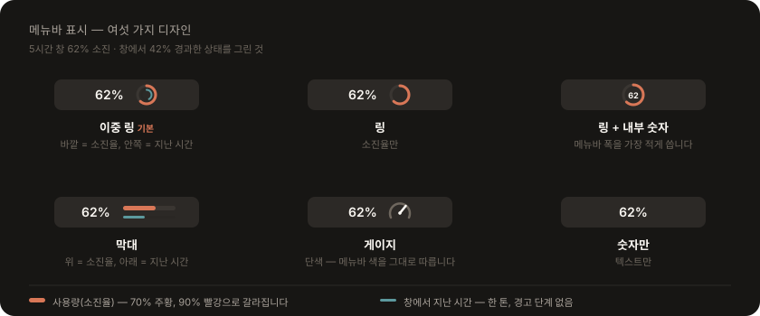
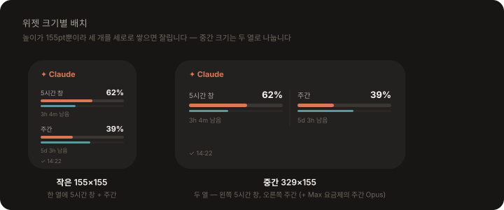

<p align="center">
  
</p>

# Claude Usage Widget

macOS **메뉴바**와 **알림센터 위젯**에서 Claude 사용량(5시간 한도 창 / 주간)을 확인합니다.

`claude.ai` 로그인 세션으로 서버가 계산한 **실제 소진율(%)** 과 리셋 시각을 가져오고, `~/.claude` 세션 로그에서 서버가 주지 않는 **토큰 상세**를 채웁니다. Claude Code·데스크톱·웹을 모두 포함한 **그 계정 전체** 사용량이며, **Claude 데스크톱 앱은 필요하지 않습니다.**

---

## 주요 기능

**메뉴바 앱** — 5시간 창 소진율을 원형 링과 숫자로 표시합니다. 안쪽 얇은 링은 «창에서 지난 시간»이라, 둘을 견주면 남은 시간보다 빨리 태우는 중인지 한눈에 보입니다. 클릭하면 토큰 상세가 담긴 패널이 열립니다.

<p align="center">
  
</p>

**알림센터·데스크톱 위젯** — 같은 소진율을 작은/중간 크기로 보여줍니다. 두 크기 모두 5시간 창과 주간을 함께 담습니다.

<p align="center">
  
</p>

| | |
|---|---|
| **실측 소진율** | 서버가 계산한 값이라 추정이 아닙니다. 정확한 리셋 시각도 함께 옵니다 |
| **토큰 상세** | 이번 5시간 창·오늘·이번 주기의 토큰 수와 모델별 분해 |
| **고를 수 있는 메뉴바 모양** | 이중 링·링·막대·게이지·숫자만 등 여섯 가지와 글자 색 |
| **곁들일 수 있는 숫자** | 주간 소진율·리셋까지 남은 시간을 아이콘 오른쪽에 덧붙입니다 |

> **소진율은 실측에서만 옵니다.** 로그인하지 않았거나 조회가 실패하면 추정치로 대신 채우지 않고 그 사유를 알립니다.

초 단위 실시간은 메뉴바 앱이 맡고, 위젯은 같은 데이터를 느리게 따라가는 보조 표시입니다 — WidgetKit 타임라인은 시스템이 수 분~수십 분 간격으로만 깨우기 때문입니다.

---

## 설치

App Store에 없습니다. **소스를 받아 직접 빌드해 설치**합니다 — 자기 머신에서 빌드하므로 Gatekeeper 경고나 별도 서명 절차가 없습니다.

| 요구 사항 | 버전 | 비고 |
|---|---|---|
| macOS | **15.0 이상** | 낮으면 스크립트가 먼저 알려 줍니다 |
| Xcode | 16 이상 | **Command Line Tools 만으로는 안 됩니다** — WidgetKit 익스텐션 타겟이 있어 Xcode 본체가 필요합니다 |
| Claude 계정 | (선택) | 실측 사용량을 쓸 때만 |

```bash
git clone <이-저장소-URL> claude-usage-widget
cd claude-usage-widget
./install.sh
```

사전 점검 → Release 빌드 → `/Applications` 설치 → 위젯 재등록 → 실행까지 한 번에 합니다. 코드를 고치거나 `git pull` 한 뒤에도 같은 명령을 다시 실행하면 됩니다.

### 로그인

설정(⚙︎) → **실측 사용량 (claude.ai)** → **연동 계정** 의 버튼을 누르면 시스템 기본 브라우저에서 `claude.ai` 가 열립니다. 거기서 계정을 고르면(이미 로그인돼 있으면 고를 것도 없이) 앱이 그 세션을 가져옵니다.

세션 값은 앱이 **어디에도 복사하지 않습니다.** 따로 저장하는 것은 «로그인이 바뀌었는지» 판단용 **지문**(sha256 앞 16자)뿐입니다.
→ [쿠키 원본, 계정·조직 선택, 프라이버시 경계](docs/usage-source.md)

### 위젯 추가

데스크톱을 우클릭 → **위젯 편집** → **Claude Code 사용량** 을 찾아 원하는 크기로 드래그합니다.

### 로그인 시 자동 실행

메뉴바 → **⚙︎ 설정** → **실행** 섹션의 토글을 켭니다. `/Applications` 밖에서 실행 중이면 경로가 바뀔 때 등록이 깨지므로 경고가 표시됩니다 — 설치 후 켜세요.

### 제거

```bash
./uninstall.sh
```

설정과 스냅샷(`~/.claude/.usage-widget-*.json`)까지 지우려면 `--purge` 를 붙입니다. 자동 실행을 켜 두었다면 먼저 토글을 끄거나, 시스템 설정 → 일반 → 로그인 항목에서 제거합니다.

---

## 더 읽기

| 문서 | 내용 |
|---|---|
| [사용량 데이터](docs/usage-source.md) | 실측 조회 · 쿠키 원본 · 계정과 조직 선택 · 로컬 로그 파싱 · 프라이버시 |
| [화면과 표시](docs/display.md) | 메뉴바 디자인 6종 · 숫자 배치 · 글자 색 · 위젯 레이아웃과 그 근거 |
| [설계](docs/architecture.md) | 파일 구조 · 샌드박스 · 프로세스 간 공유 · 기술 스택 |
| [배포 패키징](docs/packaging.md) | DMG · 서명 · 공증 · Homebrew Cask · 배포 이미지 |
| [개발](docs/development.md) | 개발 중 빌드 · 테스트 · Shared 폴더를 두 타겟이 쓰는 방법 |

---

## 라이선스

교육 및 연구 목적으로 제공되며, 필요에 따라 수정 및 재배포가 가능합니다.
