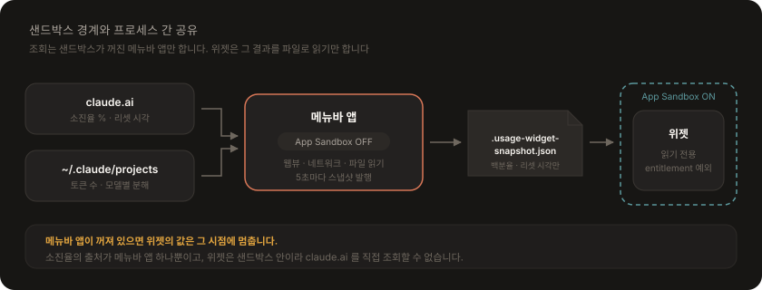

# 설계

메뉴바 앱과 위젯 익스텐션이 어떻게 나뉘고, 샌드박스 경계를 어떻게 넘는지 정리합니다.

---

## 두 프로세스로 나눈 이유

WidgetKit의 갱신 주기 때문입니다. 위젯 타임라인은 `.after(30초)`를 요청해도 시스템이 그대로 지켜주지 않고 실질 수 분~수십 분 간격으로 깨우며, 하루 갱신 예산도 제한됩니다. **초 단위 실시간은 메뉴바 앱이 담당하고, 위젯은 같은 데이터를 느리게 따라가는 보조 표시**입니다.

<p align="center">
  
</p>

| 타겟 | 샌드박스 | 접근 방식 |
|------|----------|-----------|
| 메뉴바 앱 | OFF (`ENABLE_APP_SANDBOX = NO`) | `~/.claude` 직접 읽기, 스냅샷 쓰기, **로그인 웹뷰 · claude.ai 네트워크** |
| 위젯 익스텐션 | ON | entitlement의 읽기 전용 예외로 `~/.claude` 의 스냅샷 읽기. 실측 조회는 불가 |

**메뉴바 앱이 꺼져 있으면 위젯의 값은 그 시점에 멈춥니다.** 소진율의 출처가 메뉴바 앱 하나뿐이기 때문입니다.

---

## 샌드박스와 프로세스 간 공유

위젯 익스텐션은 App Sandbox가 강제되므로 `~/.claude` 를 그냥 읽을 수 없습니다. 위젯 entitlement로 읽기 전용 예외를 둡니다:

```xml
<key>com.apple.security.temporary-exception.files.home-relative-path.read-only</key>
<array><string>/.claude/</string></array>
```

샌드박스 안에서는 `NSHomeDirectory()` 가 컨테이너(`~/Library/Containers/<bundle-id>/Data`)를 가리키므로, `ClaudeUsageReader.defaultClaudeHome` 이 경로에서 실제 홈을 복원합니다.

**App Group을 쓰지 않은 이유**: macOS의 App Group ID는 `<TeamID>.group.*` 형식이어야 하고 팀 서명이 필요합니다. 이 프로젝트는 `DEVELOPMENT_TEAM` 이 비어 있는 ad-hoc 로컬 서명이라 App Group 컨테이너를 쓸 수 없습니다. 대신 파일로 주고받습니다.

| 파일 | 쓰는 쪽 | 읽는 쪽 |
|------|---------|---------|
| `~/.claude/.usage-widget-snapshot.json` | 메뉴바 앱 (5초) | 위젯 |
| `~/.claude/.usage-widget-config.json` | 메뉴바 앱 (설정 변경 시) | 메뉴바 앱 (시작 시) |
| `~/.claude/.usage-widget-account.json` | 메뉴바 앱 (계정 확인 시) | 메뉴바 앱 (시작 시) |

> Team ID를 넣어 정식 서명으로 전환한다면, App Group 방식으로 바꾸고 위젯 entitlement의 임시 예외를 제거하는 편이 낫습니다. 임시 예외는 App Store 심사에서 거부될 수 있습니다. → [배포 패키징](packaging.md)

---

## 파일 구조

```
├── install.sh                       # 사전 점검 → Release 빌드 → /Applications 설치 → 실행
├── uninstall.sh                     # 제거 (--purge 로 설정까지)
├── package.sh                       # DMG + Homebrew Cask 생성 (서명·공증은 자격 있으면 자동)
├── signing.sh                       # 서명 자격 탐색 규칙 (install.sh·package.sh 가 공유)
├── docs/                            # 이 문서들
└── assets/                          # 배포용 이미지와 그 생성기 (톤 토큰 한 곳)
    ├── make-images.swift            # 아이콘·히어로·소셜·DMG 배경을 한 번에 렌더
    ├── hero.png                     # README 상단 배너
    ├── social-preview.png           # GitHub Settings → Social preview (1280×640)
    ├── app-icon.png                 # 1024 마스터
    └── dmg-background.tiff          # DMG 창 배경 (1x·2x 다중 해상도)

ClaudeUsageWidgetApp/
├── Shared/                          # 두 타겟이 함께 컴파일하는 코어
│   ├── UsageModels.swift            # TokenCounts, SessionBlock, ServerUsage, UsageSnapshot, 창 경계
│   ├── ClaudeUsageReader.swift      # JSONL 증분 파싱 및 창·일·주 집계
│   ├── UsageSharedStore.swift       # 스냅샷·설정 파일 읽기/쓰기
│   ├── UsageBarView.swift           # 진행 바 + 경고 단계 색
│   ├── MenuBarStyle.swift           # 메뉴바 아이콘 디자인 목록 (설정 파일에 저장)
│   ├── BrowserCookieSource.swift    # 지원 브라우저 목록·프로필 경로·UA 조립
│   ├── ClaudeSessionSource.swift    # 쿠키 원본 선택값 → 시도할 소스 순서 (순수 로직)
│   ├── ClaudeCookieJar.swift        # 쿠키와 그 쿠키를 꺼낸 곳의 UA 를 함께 들고 다님
│   ├── OrganizationChoice.swift     # 여러 조직 중 어느 것을 볼지 고르는 규칙
│   ├── ClaudeAccountResponse.swift  # /api/account 응답에서 이메일 뽑기
│   ├── ClaudeCodeAccount.swift      # ~/.claude.json 의 oauthAccount 읽기
│   ├── AccountIdentity.swift        # 연동 계정 ↔ Claude Code 계정 비교
│   └── ServerFailure.swift          # 조회 실패 분류 (401 재로그인 / 429·5xx 일시적)
│
├── ClaudeUsageWidgetApp/            # 메뉴바 앱 타겟 (샌드박스 OFF)
│   ├── ClaudeUsageWidgetAppApp.swift  # MenuBarExtra + Settings 씬
│   ├── UsageMonitor.swift             # 5초 로컬 + 서버 조회, 스냅샷 발행
│   ├── ClaudeServerUsage.swift        # claude.ai 실측 조회 (조직 선택·실패 분류 배선)
│   ├── ClaudeLoginWindow.swift        # 자체 로그인 창 (WKWebView + Google SSO 팝업)
│   ├── ClaudeWebSession.swift         # WKWebsiteDataStore 의 claude.ai 쿠키 읽기
│   ├── ClaudeSessionSource+App.swift  # 기본 브라우저 판별 + 소스별 쿠키 꺼내기 + 키 캐시
│   ├── BrowserCookieStore.swift       # 브라우저 쿠키 DB 복호화 (키체인·AES·SQLite)
│   ├── MenuBarIcon.swift              # 메뉴바 링·막대 아이콘 렌더링 (AppKit)
│   ├── UsagePanel.swift               # 메뉴바 팝오버 UI
│   ├── UsageSettingsView.swift        # 디자인 고르기 + 연동 계정·조직·갱신 주기
│   └── LaunchAtLogin.swift            # SMAppService 로그인 항목 등록
│
├── ClaudeUsageWidget/               # 위젯 익스텐션 타겟 (샌드박스 ON)
│   ├── ClaudeUsageWidgetBundle.swift
│   ├── ClaudeUsageWidget.swift
│   └── ClaudeUsageWidget.entitlements
│
├── ClaudeUsageWidgetAppTests/       # 단위 테스트 (순수 로직 위주)
└── ClaudeUsageWidgetAppUITests/
```

`Shared/` 의 순수 로직 — 조직 선택, 세션 소스 순서, 실패 분류, 창 경계, 계정 비교 — 은 각각 테스트가 있습니다. 네트워크·웹뷰가 필요 없는 부분을 그쪽으로 밀어 두었기 때문입니다.

---

## 기술 스택

| 구분 | 내용 |
|------|------|
| 언어 | Swift 5 (`SWIFT_DEFAULT_ACTOR_ISOLATION = MainActor`) |
| UI | SwiftUI (`MenuBarExtra`, `@Observable`) |
| 위젯 | WidgetKit (`StaticConfiguration`, `TimelineProvider`) |
| 배포 대상 | macOS 15.0 이상 (`MACOSX_DEPLOYMENT_TARGET`) |
| IDE | Xcode 26 (`objectVersion = 77`, 동기화된 폴더) |

앱은 `LSUIElement = YES` 라서 **Dock에 뜨지 않고 메뉴바에만** 나타납니다.

---

## 더 읽기

[사용량 데이터](usage-source.md) · [화면과 표시](display.md) · [개발](development.md)
