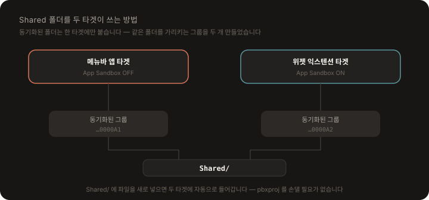

# 개발

## 빌드

```bash
xcodebuild -project ClaudeUsageWidgetApp/ClaudeUsageWidgetApp.xcodeproj -scheme ClaudeUsageWidgetApp -destination 'platform=macOS' build
```

Xcode에서는 스킴을 `ClaudeUsageWidgetApp` 으로 두고 `Cmd + R`.

앱은 `LSUIElement = YES` 라서 **Dock에 뜨지 않고 메뉴바에만** 나타납니다. 종료는 메뉴바 패널의 "종료".

> 개발 빌드와 설치 버전은 번들 ID가 같아서 위젯 등록이 서로를 덮어씁니다. 위젯이 엉뚱한 버전을 보는 것 같으면 `./install.sh` 를 다시 실행하세요.

## 테스트

```bash
xcodebuild -project ClaudeUsageWidgetApp/ClaudeUsageWidgetApp.xcodeproj -scheme ClaudeUsageWidgetApp -destination 'platform=macOS' test
```

테스트는 `Shared/` 의 순수 로직을 향합니다 — 조직 선택 규칙, 세션 소스 순서, 조회 실패 분류, 창 경계 계산, 계정 비교, 스냅샷·설정 디코딩. 네트워크나 웹뷰가 필요한 부분은 그 바깥에 두었습니다.

---

## Shared 폴더를 두 타겟이 쓰는 방법

<p align="center">
  
</p>

Xcode 26의 동기화된 폴더(`PBXFileSystemSynchronizedRootGroup`)는 폴더 하나를 한 타겟에만 붙일 수 있습니다. 그래서 `Shared` 를 가리키는 그룹을 **두 개** 만들어 각 타겟에 하나씩 붙였습니다 (`project.pbxproj` 의 `AAAA000000000000000000A1` / `A2`).

`Shared/` 에 파일을 새로 넣으면 두 타겟에 자동으로 들어갑니다 — pbxproj를 손댈 필요가 없습니다.

> 메뉴바 앱 전용 코드는 `Shared/` 에 두면 안 됩니다. 위젯 타겟도 함께 컴파일하므로 `WKWebView` 처럼 샌드박스에서 못 쓰는 것을 끌어들이면 위젯 빌드가 깨집니다. 그래서 세션 소스 **선택 규칙**은 `Shared/ClaudeSessionSource.swift` 에, 실제 **쿠키 꺼내기**는 앱 타겟의 `ClaudeSessionSource+App.swift` 에 나뉘어 있습니다.

---

## 더 읽기

[설계](architecture.md) · [배포 패키징](packaging.md)
