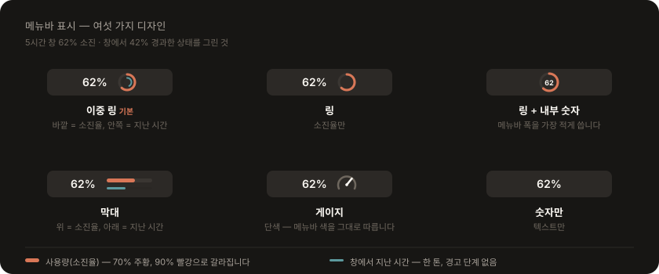
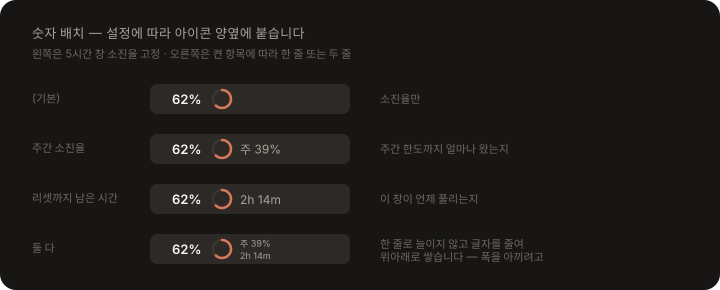
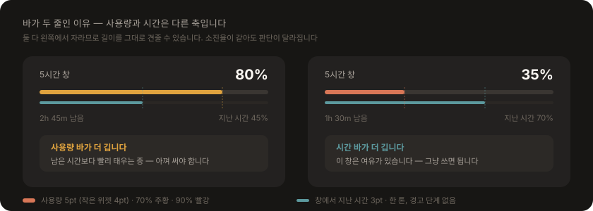
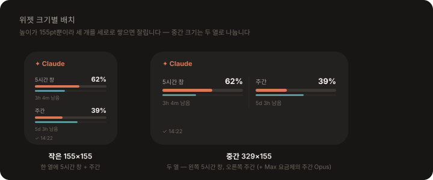

# 화면과 표시

메뉴바 아이콘과 위젯이 무엇을 어떻게 보여주는지, 그리고 왜 그렇게 그리는지 정리합니다.

---

## 메뉴바 디자인 고르기

메뉴바 → **⚙︎ 설정** → **메뉴바 표시** 에서 카드를 눌러 고릅니다. 카드에는 **지금 값이 그대로 렌더링**되므로 고르기 전에 실제 모습과 폭을 볼 수 있습니다(데이터가 아직 없으면 예시 값으로 그립니다).

  

| 디자인 | 모양 | 채우는 값 |
|---|---|---|
| **이중 링** (기본) | 링 두 겹 + 숫자 | 바깥 = 5시간 창 소진율, 안쪽 얇은 링 = 그 창에서 지난 시간 |
| 링 | 링 하나 + 숫자 | 소진율만 |
| 링 + 내부 숫자 | 링 안에 숫자 | 소진율만. 메뉴바 폭을 가장 적게 씁니다 |
| 막대 | 얇은 막대 두 겹 + 숫자 | 위 = 소진율, 아래 = 지난 시간 (패널의 진행 바와 같은 모양) |
| 게이지 | SF Symbol + 숫자 | 단색 — 메뉴바 색을 그대로 따릅니다 (v1 모양) |
| 숫자만 | 텍스트만 | — |

링·막대 색은 패널과 같은 기준입니다 — 70% 미만 테라코타, 90% 미만 주황, 그 이상 빨강. 시간 축은 청록으로 빼 두어 두 값을 견줄 수 있습니다. **사용량이 시간보다 앞서 있으면 남은 시간보다 빨리 한도를 태우는 중**입니다.

### 숫자 배치

**사용량(5시간 창 소진율)은 아이콘 왼쪽**, **주간 소진율과 남은 시간은 아이콘 오른쪽**에 붙습니다. 오른쪽에 둘 다 켜면 한 줄로 늘이지 않고 **글자를 줄여 위아래로 쌓습니다** — 폭을 아끼면서 두 값을 모두 보여주기 위해서입니다.

  

| 설정 | 라벨 |
|---|---|
| (기본) | `62%` ◍ |
| 주간 소진율 | `62%` ◍ `주 39%` |
| 리셋까지 남은 시간 | `62%` ◍ `2h 14m` |
| 둘 다 | `62%` ◍ `주 39%` / `2h 14m` (오른쪽 두 줄) |

«링 + 내부 숫자»는 소진율을 링 안에 넣으므로 왼쪽이 비고, 오른쪽만 붙습니다. 메뉴바가 좁아지면 macOS가 뒤쪽부터 잘라내므로 필요한 것만 켜는 편이 좋습니다. 실측이 아직 없으면 소진율 자리에 «—» 가 뜨고 오른쪽 항목은 생략됩니다.

### 글자 색

**글자 색** 줄에서 자주 쓰는 색 6개를 바로 누르거나, 오른쪽 색상 선택기로 임의의 색을 고릅니다. 기본값은 **검정**입니다 — 다크 모드 메뉴바에서는 읽히지 않으므로 **흰색**(두 번째 프리셋)으로 바꿔 쓰세요. 링·막대의 **사용량 색은 경고 단계를 나타내는 값이라 이 설정을 따르지 않습니다.**

### 왜 라벨 전체를 AppKit으로 그리는가

`MenuBarExtra`의 `label`은 SwiftUI 뷰를 그대로 그리지 않습니다. 내부적으로 `NSStatusItem`의 `image`와 `title`로만 뽑아 쓰기 때문에, 실측해 보면 이렇게 동작합니다.

- `Shape`·`Canvas`·`GeometryReader`는 아무것도 그려지지 않습니다.
- `Text`를 `Image` **앞**에 두어도 항상 «이미지 → 글자» 순서로 나옵니다(선언 순서 무시).
- `VStack`으로 `Text`를 두 줄 쌓으면 그 블록이 **통째로 사라집니다.**
- `Text`에 준 `.foregroundStyle`은 무시됩니다.

그래서 위의 «왼쪽/오른쪽 배치», «두 줄 축소 표기», «글자 색 지정»은 SwiftUI 라벨로는 불가능하고, 라벨 전체(링·막대·글자)를 한 장의 `NSImage`로 직접 그려 `Image(nsImage:)` 하나로 넘깁니다([MenuBarIcon.swift](../ClaudeUsageWidgetApp/ClaudeUsageWidgetApp/MenuBarIcon.swift)). 색을 살려야 하므로 템플릿 이미지로 두지 않고, 그래서 링의 빈 부분과 기본 글자색은 동적 색 대신 앱의 유효 외관을 보고 고른 값을 씁니다 — 동적 색은 NSImage가 어느 외관에서 래스터화되는지에 따라 배경에 묻힐 수 있습니다. 글자를 이미지로 그리면 VoiceOver가 읽을 것이 없어지므로 `accessibilityDescription`에 같은 내용을 넣습니다.

이미지 크기는 메뉴바가 24pt까지 자르지 않고 받는 것을 확인했고, 표준 메뉴바에서 위아래 여백이 남도록 링은 **20pt**, 라벨 전체 높이는 22pt 이하로 둡니다.

---

## 위젯이 보여주는 것

위젯은 **스냅샷만 읽습니다.** 샌드박스 안에서는 `claude.ai` 를 조회할 수 없으니 소진율의 출처가 메뉴바 앱 하나뿐이고, 위젯이 로그를 직접 파싱해도 소진율은 나오지 않습니다. → [설계](architecture.md)

바마다 **소진율(%) + 리셋까지 남은 시간**을 적고, 하단에 **조회 시각**을 둡니다.

| | 5시간 창 / 주간 바 | 하단 |
|---|---|---|
| 실측이 있을 때 | `62%` · `3h 4m 남음` (서버가 준 `resets_at`) | `✓ 14:22` |
| 실측이 없을 때 | 그리지 않음 | 사유 — `claude.ai에 로그인하면 표시됩니다` 또는 조회 실패 문구 |

**낡았다고 실측을 버리지 않습니다.** 위젯 타임라인은 `.after(5분)` 을 요청해도 시스템이 실질 수 분~수십 분 간격으로 깨우므로, 위젯의 값은 구조적으로 조금 낡아 있습니다. 버리면 화면이 비고 대신 그릴 것이 없으므로, 조금 낡은 참값을 그대로 두고 **조회 시각을 적어 신선도를 읽는 사람이 판단**하게 합니다.

리셋이 지난 창만 버립니다. 그건 낡은 값이 아니라 **지난 창의 값**이라 성격이 다릅니다. 그때는 «새 한도 창을 불러오는 중…» 을 표시하고, 메뉴바 앱이 다음 조회에서 새 창을 받아옵니다.

### 바가 두 줄인 이유 — 사용량과 시간은 다른 축입니다

한도 창은 «얼마나 썼는가»와 «창이 얼마나 지났는가»가 함께 있어야 판단이 됩니다(80%인데 4시간 남았으면 아껴야 하고, 80%인데 10분 남았으면 그냥 쓰면 됩니다). 그래서 바마다 두 줄을 그립니다.

  

| | 두께 | 색 | 채우는 값 |
|---|---|---|---|
| 사용량(소진율) | 5pt (작은 위젯 4pt) | accent `#D97757` → 70% 주황 → 90% 빨강 | 한도 중 쓴 비율 |
| 창에서 지난 시간 | 3pt | 청록 `#5C999E` 한 톤 (경고 단계 없음) | 창 길이 중 지나간 비율 |

**둘 다 왼쪽에서 자랍니다.** 같은 방향으로 두면 두 바의 길이를 그대로 견줄 수 있어 소진 속도가 한눈에 보입니다 — 사용량 바가 시간 바보다 길면 시간보다 빨리 태우는 중이고, 짧으면 이 창은 여유가 있습니다. 두 바의 구분은 색과 두께가 맡습니다.

시간 색은 accent의 보색 쪽으로 빼되 채도·명도를 accent에 맞춰 두 바가 같은 팔레트로 읽히게 했습니다. 시간이 흐르는 것 자체는 나쁜 상태가 아니므로 경고 단계는 두지 않습니다. 바 아래 글자는 그대로 **리셋까지 남은 시간**(`2h 14m 남음`)이라 채워진 부분과 남은 부분을 각각 눈과 숫자로 읽습니다.

### 크기별 배치

  

| 크기 | 배치 |
|---|---|
| 작은 (155×155) | 한 열에 **5시간 창 + 주간**. 줄 간격·바 두께를 줄여 155pt 안에 헤더·바 두 개·배지가 잘리지 않고 들어갑니다 |
| 중간 (329×155) | **두 열** — 왼쪽 5시간 창, 오른쪽 주간(+ Max 요금제의 주간 Opus). 높이가 155pt뿐이라 세 개를 세로로 쌓으면 잘립니다 |

> 작은 위젯도 주간을 함께 보여줍니다. 5시간 창만으로는 주간 한도에 얼마나 다가섰는지 알 수 없습니다. 예전에는 바를 세로로 쌓으면서 간격이 넉넉해 주간 바가 위젯 밖으로 밀려 보이지 않았습니다 — `GeometryReader` 로 그리는 바는 공간이 모자라면 높이 0으로 접힙니다.

---

## 관련 코드

[MenuBarIcon.swift](../ClaudeUsageWidgetApp/ClaudeUsageWidgetApp/MenuBarIcon.swift) · [MenuBarStyle.swift](../ClaudeUsageWidgetApp/Shared/MenuBarStyle.swift) · [UsagePanel.swift](../ClaudeUsageWidgetApp/ClaudeUsageWidgetApp/UsagePanel.swift) · [UsageSettingsView.swift](../ClaudeUsageWidgetApp/ClaudeUsageWidgetApp/UsageSettingsView.swift) · [UsageBarView.swift](../ClaudeUsageWidgetApp/Shared/UsageBarView.swift) · [ClaudeUsageWidget.swift](../ClaudeUsageWidgetApp/ClaudeUsageWidget/ClaudeUsageWidget.swift)
