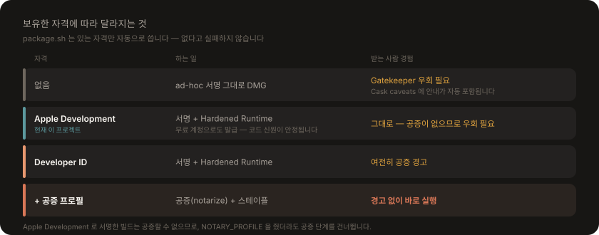

# 배포 패키징

`.app` 을 DMG 로 묶고 Homebrew Cask 파일을 만듭니다. 직접 빌드해 쓰기만 한다면 [`./install.sh`](../install.sh) 로 충분하고, 이 문서는 **남에게 건네줄 빌드**를 만들 때 봅니다.

```bash
./package.sh
```

산출물은 `dist/` 에 생깁니다 — `ClaudeUsageWidget-<버전>.dmg` 와 `claude-usage-widget.rb`(SHA256·버전·최소 OS 가 채워진 Cask). 스크립트는 **있는 자격만 자동으로 씁니다.**

DMG 는 `assets/` 가 있으면 **창 배경·볼륨 아이콘·아이콘 배치까지 입혀** 만듭니다 (rw 이미지로 만들어 마운트 → Finder 로 창을 꾸미고 → UDZO 로 압축). Finder 자동화 권한이 없으면 꾸미기만 건너뛰고 평범한 DMG 가 나옵니다 — 실패로 끝나지 않습니다.

---

## 서명과 공증

`install.sh` 와 `package.sh` 는 [signing.sh](../signing.sh) 의 같은 규칙으로 자격을 찾습니다.

<p align="center">
  
</p>

```
1. Developer ID Application  — 배포용. 공증까지 갈 수 있는 유일한 자격
2. Apple Development         — 무료 계정으로도 발급된다. 공증은 못 하지만 신원은 안정된다
3. 없으면 ad-hoc
```

| 보유 자격 | 하는 일 | 받는 사람 경험 |
|---|---|---|
| 없음 | ad-hoc 서명 그대로 DMG | Gatekeeper 우회 필요 — Cask `caveats` 에 안내가 자동 포함됨 |
| Apple Development (현재) | 서명 + Hardened Runtime. **코드 신원이 안정됨** | 그대로 — 공증이 없으므로 Gatekeeper 우회 필요 |
| Developer ID 인증서 | 서명 + Hardened Runtime | 여전히 공증 경고 |
| + 공증 프로필 | 공증(notarize) + 스테이플 | **경고 없이 바로 실행** |

`SIGN_ID` 환경변수로 직접 지정할 수도 있습니다. Apple Development 로 서명한 빌드는 공증할 수 없으므로, `NOTARY_PROFILE` 을 줬더라도 공증 단계를 건너뜁니다 — 올려서 거부당하게 두지 않습니다.

```bash
# 유료 가입 후 — 인증서는 자동 감지되고, 공증만 프로필을 지정합니다
xcrun notarytool store-credentials notary --apple-id <id> --team-id <team>
NOTARY_PROFILE=notary ./package.sh
```

> **Hardened Runtime 과 WKWebView** — 인증서로 서명하면 `package.sh` 가 Hardened Runtime 을 켭니다. 그 아래에서도 로그인 창이 정상 동작합니다(패키징한 DMG 로 확인). WKWebView 의 웹 콘텐츠는 Apple 이 서명한 별도 XPC 프로세스(`com.apple.WebKit.WebContent`)에서 돌아가므로, JavaScriptCore 의 JIT 이 우리 앱의 런타임 제한을 받지 않습니다. `com.apple.security.cs.allow-jit` 같은 예외는 필요하지 않습니다.
>
> `install.sh` 는 Hardened Runtime 을 켜지 않습니다 — 로컬 설치에 필요하지 않고, 공증 요건인 배포용에서만 켭니다.

### 공증하지 않은 빌드의 한계

Apple Developer Program(유료, $99/년) 없이는 **공증할 수 없습니다.** 이때 받는 사람은 quarantine 속성을 지워야 합니다:

```bash
xattr -dr com.apple.quarantine /Applications/ClaudeUsageWidgetApp.app
```

> `spctl -a` 는 이 앱을 항상 `rejected` 로 판정합니다(ad-hoc 서명이므로). 하지만 그건 **정책 평가 결과**이고 실행 차단과 다릅니다 — Gatekeeper 가 실제로 막는 것은 **quarantine 속성이 붙어 있을 때**뿐이라, 위 명령이면 정상 실행됩니다. 직접 빌드해 설치하는 경우(`./install.sh`)는 애초에 quarantine 이 붙지 않아 아무 조치가 필요 없습니다.

### ad-hoc 서명이 왜 문제인가

ad-hoc 서명의 designated requirement 는 `cdhash` 하나입니다.

```
designated => cdhash H"cb541b976398ed6fffff04c493c2f082d385c341"
```

바이너리가 1비트만 바뀌어도 **다른 신원**이 됩니다. 그러면 코드 신원에 묶인 상태 — 로그인 항목 등록(`SMAppService`), TCC 허용 — 가 재빌드마다 초기화됩니다. 인증서로 서명하면 DR 이 이렇게 바뀝니다.

```
designated => identifier "sdh.ClaudeUsageWidgetApp" and anchor apple generic
  and certificate leaf[subject.CN] = "Apple Development: … (TEAMID)"
  and certificate 1[field.1.2.840.113635.100.6.2.1]
```

`cdhash` 가 없으므로 바이너리가 바뀌어도 같은 신원입니다. 인증서를 갱신해도 CN 이 같으면 그대로 유지됩니다.

> 예전에는 이 문제가 훨씬 크게 나타났습니다. 실측 사용량을 위해 키체인의 `Claude Safe Storage` 를 읽던 시절에는 **업데이트마다 키체인 허용 창이 다시 떴습니다.** 자체 로그인으로 바꿔 그 키체인 항목을 쓰지 않게 되면서 증상은 사라졌고, 남은 이득은 로그인 항목·TCC 상태의 안정성입니다.
>
> 서명 주체를 바꾸면 DR 이 달라지므로 **전환 직후 한 번은** 기존에 부여된 상태가 초기화됩니다. 그 뒤로는 안정됩니다.

---

## Homebrew 로 배포하기

> **지금은 tap 을 운영하지 않습니다.** 설치는 릴리스의 DMG 나 `./install.sh` 로 합니다. `package.sh` 는 Cask 파일을 계속 만들어 두므로, tap 을 열 때 아래 절차를 그대로 쓰면 됩니다.

GUI 앱이므로 **Cask** 를 씁니다. 공식 `homebrew-cask` 는 notability 요건과 심사가 있어 개인 프로젝트는 **자체 tap** 이 현실적입니다.

```bash
# 1. 릴리스에 DMG 올리기
gh release create v1.0 dist/ClaudeUsageWidget-1.0.dmg --title v1.0

# 2. homebrew-tap 저장소(이름이 homebrew- 로 시작해야 합니다)의 Casks/ 에 복사
cp dist/claude-usage-widget.rb ../homebrew-tap/Casks/

# 3. 받는 사람
brew tap <사용자>/tap
brew install --cask claude-usage-widget       # 공증 안 된 빌드면 --no-quarantine 추가
```

> 원격(`origin`)이 설정돼 있으면 Cask 의 `url` 이 자동으로 채워집니다. 없으면 `YOUR_GITHUB_USER` 자리표시자가 들어가니 치환하세요.

---

## 배포 이미지

이미지는 모두 [`assets/make-images.swift`](../assets/make-images.swift) 하나가 그립니다. 색·형태·모티프 토큰이 그 파일 맨 위 `enum T` 에만 있어, 코랄 값을 하나 바꾸면 아이콘·README 배너·DMG 배경이 함께 따라옵니다.

```bash
./assets/make-images.swift
```

| 산출물 | 크기 | 쓰는 곳 |
|---|---|---|
| `ClaudeUsageWidgetApp/…/AppIcon.appiconset` | 16~1024 (1x·2x) | 앱 아이콘 — 에셋 카탈로그에 직접 씁니다 |
| `ClaudeUsageWidget/…/AppIcon.appiconset` | 16~256 | **위젯 갤러리(«위젯 편집») 목록 아이콘.** 익스텐션 번들이 자기 아이콘을 들고 있어야 뜨므로 같은 아트를 넣습니다 (목록은 작게 쓰므로 256까지) |
| `assets/hero.png` | 2400×760 | README 상단 배너 |
| `assets/social-preview.png` | 1280×640 | GitHub 저장소 **Settings → Social preview** 에 수동 업로드 |
| `assets/dmg-background.tiff` | 640×400 (1x·2x) | DMG 창 배경 — `package.sh` 가 집어 씁니다 |
| `assets/app-icon.png` | 1024×1024 | 릴리스 노트·스토어 등에 쓰는 마스터 |

톤은 앱 UI 와 같은 계열입니다 — 진행 바의 `AccentColor` 가 아이콘 바탕과 같은 코랄(`#D97757`)이고, 경고·위험 단계만 주황·빨강으로 갈라집니다. 볼륨 아이콘은 앱 아이콘 PNG 를 `iconutil` 로 묶어 만들기 때문에 따로 관리할 파일이 없습니다.

작은 크기(16·32px)는 축소만 하지 않고 **반짝임을 빼고 링을 굵게** 그린 별도 변형을 씁니다 — 그대로 줄이면 두 요소가 뭉개져 무엇인지 읽히지 않습니다.

`docs/images/` 의 설명용 다이어그램은 손으로 그린 SVG 라 이 생성기와 무관합니다. 같은 팔레트만 따릅니다.
