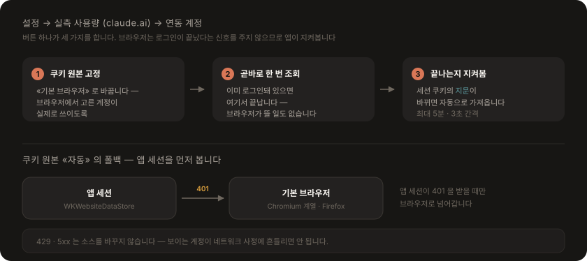

# 사용량 데이터

이 앱은 두 개의 데이터 소스를 씁니다. 역할이 다르고, 서로를 대신하지 않습니다.

| 소스 | 주는 것 | 범위 |
|---|---|---|
| **claude.ai 실측** | 소진율(%) · 정확한 리셋 시각 | 로그인한 **계정 전체** (Claude Code · 데스크톱 · 웹) |
| **로컬 세션 로그** | 토큰 수 · 모델별 분해 | **Claude Code** 활동만 |

**화면의 모든 소진율은 실측에서만 옵니다.** 실측이 없으면 소진율을 추정해 대신 채우지 않고 사유를 알립니다.

---

## 1. 실측 사용량 — 로그인 세션으로 계정 전체 사용량 불러오기

`claude.ai`에 로그인한 세션으로 서버가 계산한 실제 사용량을 받아옵니다. 세션은 두 곳에서 올 수 있고, 설정의 **쿠키 원본**에서 고릅니다. **Claude 데스크톱 앱은 어느 쪽에도 필요하지 않습니다.**

<p align="center">
  
</p>

### 로그인·계정 선택은 기본 브라우저에서

설정 → 실측 사용량 (claude.ai) → **연동 계정**의 버튼이 시스템 기본 브라우저에서 `claude.ai`를 엽니다. 평소 쓰는 브라우저에서 계정을 고르면 그 세션을 그대로 씁니다. 앱은 자기 로그인 창을 띄우지 않습니다.

버튼 하나가 세 가지를 합니다:

```
1. 쿠키 원본을 «기본 브라우저» 로 고정한다      — 브라우저에서 고른 계정이 실제로 쓰이도록
2. 곧바로 한 번 조회한다                        — 이미 로그인돼 있으면 여기서 끝
3. 브라우저를 열고 로그인이 끝나는지 지켜본다    — 끝나면 자동으로 가져온다 (최대 5분, 3초 간격)
```

- `NSWorkspace.open`이 LaunchServices에 맡기므로 **사용자가 기본으로 지정한 브라우저**가 그대로 열립니다.
- 브라우저는 로그인이 끝났다는 신호를 앱에 주지 않습니다. 그래서 세션 쿠키의 **지문**(`sessionFingerprint`)이 생기거나 바뀔 때까지 짧은 간격으로 확인합니다. 지문만 비교하므로 세션 값 자체는 그 경로로 흘러나오지 않습니다.
- **Safari가 기본 브라우저면** 쿠키를 읽을 수 없으므로 앱 안의 로그인 창으로 넘어갑니다. 그때만 `WKWebView` 창이 뜹니다.

### 쿠키 원본 — 세션을 어디서 읽을지

| 선택 | 세션을 읽는 곳 |
| --- | --- |
| **자동** (기본) | 앱 세션 → 만료(401)되면 기본 브라우저 |
| 앱 안의 로그인 창 | `WKWebsiteDataStore` 하나만 |
| 기본 브라우저 | 그 브라우저의 쿠키 저장소 → 읽을 수 없으면 앱 세션 |
| 특정 브라우저 | 고른 브라우저의 쿠키 저장소 → 읽을 수 없으면 앱 세션 |

브라우저를 고른 경우에도 **앱 세션이 마지막 후보로 남습니다.** OS 가 브라우저 프로필 폴더를 통째로 막을 수 있어서(바로 아래), 후보가 하나뿐이면 그 순간 빠져나올 길이 없어지기 때문입니다. 고른 소스가 아닌 쪽으로 넘어갔으면 패널과 설정이 그 사실을 알립니다 — 다른 소스는 곧 다른 로그인일 수 있어, 조용히 넘어가면 남의 계정 숫자를 자기 것으로 읽게 됩니다. «앱 안의 로그인 창»을 직접 고른 경우에는 폴백이 붙지 않습니다. 그 선택은 «브라우저를 쓰지 않겠다»는 뜻입니다.

연동 계정 버튼으로 로그인하면 원본이 «기본 브라우저» 로 바뀌므로, 보통은 이 설정을 직접 건드릴 일이 없습니다.

**«자동»이 앱 세션을 먼저 보는 이유**: 브라우저를 먼저 보면, 이미 앱에 A계정을 연동해 둔 사용자가 브라우저의 B계정으로 조용히 바뀝니다. 앱 세션이 **401을 받을 때만** 브라우저로 넘어가므로, 소스 전환은 재로그인이 필요한 순간이나 사용자가 직접 로그인 버튼을 눌렀을 때만 일어납니다. 일시적 실패(429·5xx)에는 소스를 바꾸지 않습니다 — 그러면 보이는 계정이 네트워크 사정에 따라 흔들립니다.

**지원 브라우저**: Chromium 계열(Chrome·Edge·Brave·네이버 웨일·Arc·Vivaldi·Chromium)과 Firefox.

```
Chromium:  ~/Library/Application Support/<브랜드>/<프로필>/Cookies   (SQLite, 값은 암호화)
  1. 키체인의 "<브랜드> Safe Storage" 항목이 base64 문자열 키
  2. PBKDF2-HMAC-SHA1(key, salt="saltysalt", 반복 1003회, 16바이트)
  3. AES-128-CBC, IV = 공백 16바이트 — encrypted_value 에서 "v10"/"v11" 접두사를 뺀 본문
  4. 최신 Chromium 은 평문 앞에 sha256(host_key) 32바이트를 붙인다 → 있으면 떼어낸다
Firefox:   ~/Library/Application Support/Firefox/Profiles/<프로필>/cookies.sqlite  (평문)
```

- 브라우저 쿠키를 처음 읽을 때 **키체인 접근 허용 창이 한 번** 뜹니다(«항상 허용»). 복호화 키는 앱 실행당 브라우저별로 한 번만 유도해 메모리에 캐시합니다.
- 프로필이 여러 개면(`Default`, `Profile 1` …) 최근에 쓴 프로필부터 보며 세션 쿠키가 있는 첫 프로필을 씁니다.
- 브라우저가 쥔 파일을 잠그지 않도록 사본을 떠서 읽고, 방금 받은 쿠키가 아직 `-wal`에만 있을 수 있어 곁다리 파일도 함께 복사합니다.
- **Safari는 지원하지 않습니다.** 쿠키가 `binarycookies` 형식이라 읽을 수 없습니다. Safari가 기본 브라우저면 «자동»은 앱 세션만 쓰고, «기본 브라우저»를 고르면 그 사유를 그대로 알립니다.

#### macOS 27 부터는 권한이 필요합니다

macOS 27 이 TCC 서비스 `kTCCServiceSystemPolicyAppDataDetailed` 로 **브라우저 프로필 폴더를 보호**하기 시작했습니다. 보호 목록에는 Chrome·Brave·Edge·Firefox 가 모두 올라 있어, **Safari 를 뺀 지원 브라우저 전부**가 해당합니다.

권한이 없는 앱에게 이 보호는 이렇게 보입니다 — 메타데이터(`stat`)는 통과하고, **열거(`readdir`)와 열기(`open`)만 막힙니다.** 그래서 «파일이 없다»와 구분하기 어렵고, 실제로 1.4 는 막힌 것을 «쿠키 파일이 없습니다» 로 보고했습니다.

```
전체 디스크 접근을 허용한다        → 브라우저 쿠키를 그대로 쓴다
쿠키 원본을 «앱 안의 로그인 창»    → 권한 없이 쓴다 (앱에서 한 번 로그인)
```

**OS 는 허용 창을 띄우지 않습니다.** 묻지 않고 막으므로, 권한은 사용자가 직접 추가해야 합니다. 그래서 설정의 사유 아래에 두 갈래를 버튼으로 둡니다. 권한을 허용한 뒤 «지금 다시 조회»를 눌러도 같은 사유가 나오면 앱을 다시 켜세요.

브라우저가 막혀도 조회가 멈추지는 않습니다 — 앱 세션이 있으면 그쪽으로 넘어가고, 넘어간 사실과 사유를 함께 알립니다.

→ 배경과 버린 선택지는 [ACR-0001](acr/0001-macos-27-app-data-protection.md)
- **UA는 쿠키를 꺼낸 곳에 맞춥니다.** `cf_clearance`가 UA에 묶여 있어서, 브라우저 쿠키를 웹뷰의 Safari UA로 보내면 같은 쿠키인데도 Cloudflare 챌린지를 받을 수 있습니다. 그래서 `ClaudeCookieJar`가 UA를 쿠키와 함께 들고 다니고, Chromium 계열이면 설치된 그 브라우저의 실제 메이저 버전으로 Chrome UA를 만듭니다. (TLS 지문까지 맞추지는 못하므로, 앱 로그인 창 쪽이 Cloudflare 관점에서는 여전히 더 안전합니다.)

### 앱 로그인 창으로 세션 확보 (Safari가 기본이거나 직접 골랐을 때)

```
1. 설정 → 실측 사용량 (claude.ai) → 쿠키 원본을 «앱 안의 로그인 창» 으로 두고 «Claude 로그인»
2. 앱 안의 로그인 창에서 사용자가 직접 로그인 (이메일 코드 / Google SSO)
3. 세션 쿠키가 생기면 창이 자동으로 닫힌다
4. 세션은 WKWebsiteDataStore(persistent)에 남아 앱을 다시 켜도 유지된다 (대략 4주)
```

- 앱은 세션 값을 **어디에도 복사하지 않습니다.** WebKit 저장소에 그대로 두고 조회할 때 쿠키를 읽습니다.
- 로그인 창과 조회가 **같은 저장소**를 쓰므로 `cf_clearance`·UA가 일관됩니다. 쿠키만 뽑아 다른 클라이언트로 옮기면 Cloudflare 챌린지를 받을 수 있습니다.
- 필요한 쿠키: `sessionKey`(로그인 세션), `lastActiveOrg`(조직 UUID). 실제로는 `claude.ai` 도메인 쿠키 전체를 브라우저처럼 함께 보냅니다. **다른 도메인(Google·hCaptcha) 쿠키는 걸러냅니다** — SSO 왕복에서 같은 저장소에 함께 쌓이므로 필터가 없으면 남의 도메인 자격증명이 `claude.ai` 요청에 실려 나갑니다.
- **Google 로그인은 팝업으로 진행됩니다.** `WKUIDelegate.createWebViewWith`를 구현하지 않으면 `WKWebView`가 `window.open`을 조용히 버리고 SSO가 콜백을 받지 못해 "로그인 중 오류"로 끝납니다. 구현하면 `accounts.google.com` 왕복이 정상 완주합니다 — `disallowed_useragent` 차단은 없고 UA를 바꿀 필요도 없습니다(기본 Safari 계열로 확인).
- 팝업 창을 배열에 들고 있는 상태에서 `close()`를 부르면 과다 해제로 죽습니다. `NSWindow.isReleasedWhenClosed = false` 가 필요하고, `webViewDidClose` 는 WebKit 이 그 웹뷰를 아직 쓰는 중에 오므로 창 정리를 다음 런루프로 미뤄야 합니다.

### 사용량 API

```
GET https://claude.ai/api/organizations/{org_uuid}/usage
Cookie: <고른 쿠키 원본의 claude.ai 쿠키 전체>
User-Agent: <그 쿠키를 꺼낸 곳의 UA>
```

```jsonc
{
  "five_hour": { "utilization": 62.0, "resets_at": "2026-07-29T13:39:59.6+00:00" },
  "seven_day": { "utilization": 39.0, "resets_at": "2026-08-04T05:59:59.6+00:00" },
  "seven_day_opus": null,          // Max 요금제의 주간 Opus 한도(있으면)
  "limits": [ /* session·weekly_all 등 */ ]
}
```

### 어느 계정·어느 조직을 볼지

한 로그인이 여러 조직에 속할 수 있고(개인 Pro + 팀 시트), 어느 조직을 보느냐에 따라 숫자가 달라집니다. 실제 계정에서 관측된 배치입니다(이름은 가명):

| 순서 | 이름 | capabilities |
|---|---|---|
| 1 | 개인 조직 | `api`, `api_individual` |
| 2 | 팀 조직 | **`chat`**, `raven` |

`chat` 권한이 없는 조직이 목록의 **첫 번째**입니다. 그래서 "첫 조직"을 쓰면 사용량 한도가 없는 조직을 잡습니다. 선택 규칙은 이렇습니다.

```
1. 설정에서 고른 조직이 목록에 있으면 그것
2. 없으면 쿠키의 lastActiveOrg
3. 없으면 chat 권한이 있는 첫 조직
4. 없으면 목록의 첫 조직
```

고른 조직이 목록에서 사라지면(탈퇴·계정 변경) 자동 선택으로 내려가되 **그 사실을 알립니다** — 조용히 다른 조직 숫자를 사용자 것으로 보여주지 않습니다. 여러 조직이 있으면 설정에 **조직** 선택이 나타납니다.

**토큰 상세와 계정이 다를 수 있습니다.** 상세는 늘 `~/.claude/projects` 로그, 즉 **Claude Code 계정**의 활동입니다. 연동 계정이 그와 다르면 패널의 상세 헤더가 «Claude Code 로컬 상세 · other@example.com» 으로 바뀝니다. 조회가 실패하면 사유가 뜨지만 계정이 어긋나면 숫자가 멀쩡하게 나오므로, 적어 주지 않으면 구분할 방법이 없습니다.

두 쪽을 이렇게 알아냅니다.

| 쪽 | 출처 | 비용 |
|---|---|---|
| Claude Code 계정 | `~/.claude.json` 의 `oauthAccount` | 인증 불필요, 파일 읽기 |
| 연동 계정 | `GET /api/account` → `email_address` | 로그인·조직이 **바뀔 때만** 1회 |

이메일까지 비교하는 이유는 **조직 UUID가 같아도 계정은 다를 수 있기** 때문입니다 — 같은 팀 조직의 다른 멤버로 로그인한 경우입니다. 이메일을 못 얻으면 조직 단위 비교로 자동 축소됩니다.

계정 정보는 `~/.claude/.usage-widget-account.json` 에 캐시하고, **세션 지문이 바뀌거나 조직이 바뀔 때만** 다시 조회합니다. 지문은 세션 쿠키의 sha256 앞 16자이고, 쿠키 원본은 저장하지 않습니다.

---

## 2. 로컬 데이터 소스 (토큰 상세)

서버는 소진율(%)과 리셋 시각만 주고 토큰 수·모델별 분해는 주지 않습니다. 그 빈자리를 Claude Code 세션 로그로 채웁니다.

```
~/.claude/projects/<encoded-cwd>/<session-id>.jsonl
```

`type: "assistant"` 인 줄의 `message.usage` 에서 토큰을 집계합니다.

- **중복 제거**: 같은 요청이 여러 줄에 기록되므로 `requestId`(없으면 `message.id`) 기준으로 한 번만 셉니다.
- **창 경계는 실측에서 받습니다**: 5시간 창의 시작은 서버가 준 `resets_at` 에서 5시간을, 주간 주기의 시작은 7일을 뺀 값입니다. 로그의 첫 요청 시각으로 창을 추정하지 않습니다 — 창을 여는 요청이 Claude 데스크톱·웹에서 나갔으면 로컬 로그에 없어 시작이 늦게 잡히고, 그러면 그 창의 요청 수와 토큰이 통째로 모자라게 나옵니다.
- **경계를 모르면 집계하지 않습니다**: 실측이 없는 동안(미로그인·세션 만료·조회 실패) 5시간 창과 주간 줄은 화면에서 빠집니다. 최근 7일 롤링 같은 근사치를 대신 넣지 않습니다 — 주간 한도는 롤링이 아니라 고정 주기로 리셋되므로 롤링으로 세면 지난 주기 사용량이 섞입니다. **오늘** 사용량만 경계가 로컬 자정이라 늘 남습니다.
- **증분 파싱**: 파일별로 읽은 바이트 위치를 기억해 새로 붙은 부분만 파싱합니다. 마지막 개행 이후는 쓰는 중일 수 있어 다음 회차로 넘깁니다.

표시는 로그에 적힌 토큰만 씁니다 — **캐시 읽기를 제외한 합계**와 **캐시 읽기**를 나눠 적습니다. Claude Code 는 대화 컨텍스트를 매 요청 캐시에서 다시 읽기 때문에 캐시 읽기 토큰이 나머지의 수십 배가 되고, 둘을 합쳐 한 숫자로 만들면 그 사실이 가려집니다.

비용 환산(예상 금액)은 두지 않습니다. 모델별 단가표를 앱이 들고 있어야 하고, 그렇게 계산한 값이 요금제별 실제 청구와 맞는지 확인할 방법이 없습니다.

> 이 로그에는 **Claude 데스크톱 앱 / claude.ai 사용량이 없습니다.** 그쪽 소비량은 서버에만 있습니다. 소진율은 실측에서 오므로 영향이 없지만, 토큰 상세는 Claude Code 몫만 셉니다.

---

## 경계·프라이버시

- **키체인을 쓰지 않습니다**: 비밀번호 프롬프트가 뜨지 않습니다. 이전에는 Claude 데스크톱 앱이 만든 `Claude Safe Storage` 항목을 읽었고, ad-hoc 서명 때문에 재빌드마다 허용 창이 다시 떴습니다. (브라우저 쿠키 원본을 쓸 때 그 브라우저의 Safe Storage 키를 읽는 것은 별개이며, 그때만 허용 창이 한 번 뜹니다.)
- **샌드박스**: 웹뷰·네트워크는 샌드박스가 꺼진 **메뉴바 앱**만 씁니다. 위젯(샌드박스 ON)은 조회를 직접 하지 못하고, 메뉴바 앱이 스냅샷에 넣어 준 실측 %를 읽기만 합니다 — 그래서 메뉴바 앱이 꺼져 있으면 위젯의 값이 그 시점에 멈춥니다. → [설계](architecture.md)
- **세션은 어디에도 복사하지 않습니다**: WebKit 저장소에만 있고, 앱이 따로 저장하는 것은 **세션 지문(sha256 앞 16자)** 뿐입니다. 지문은 "로그인이 바뀌었는지" 판단에만 씁니다. 스냅샷에는 서버가 준 **백분율·리셋 시각**만 담깁니다.
- **앱을 지우면 세션도 지웁니다**: `./uninstall.sh` 는 설정과 달리 `--purge` 없이도 웹 저장소를 지웁니다 — 앱을 지웠는데 로그인이 디스크에 남아 있으면 안 되기 때문입니다.
- **조회 주기 설정**: 설정 → 실측 사용량 (claude.ai) → **갱신 주기** 에서 30초·1분(기본)·3분·5분·10분·30분·**수동** 중 고릅니다. '수동'은 앱 시작 때 1회만 가져오고 이후엔 패널의 새로고침 버튼으로만 갱신합니다.
- **세션이 만료되면**(401/403) 다시 로그인하라고 알립니다. 429·5xx 는 일시적 실패로 보고 재로그인을 요구하지 않습니다 — 멀쩡한 세션을 버리게 만들면 안 됩니다.
- **사유가 여럿이면 권한 거부가 앞섭니다.** 소스를 차례로 시도하므로 실패 사유도 여럿 생길 수 있습니다. 권한 거부는 사용자가 손쓰지 않으면 영영 풀리지 않는 유일한 사유라, 뒤에 시도한 소스의 «로그인하세요»에 덮이지 않게 합니다 — 덮이면 엉뚱한 곳에서 로그인만 반복하게 됩니다.
- **계정을 바꾸려면**: 설정 → 실측 사용량 (claude.ai) → 연동 계정의 «계정 선택» 이 브라우저를 엽니다. 브라우저 세션은 앱이 끊을 수 없으므로(그 브라우저의 로그인입니다) 계정 전환도 거기서 합니다. 앱 안의 로그인 창을 쓰는 중이면 버튼이 «다른 계정» 이고, 웹 저장소와 계정 캐시를 비운 뒤 다시 로그인합니다. 표시만 끄는 토글은 두지 않습니다 — 소진율의 출처가 이것뿐이라 끄면 빈 화면이 남고, 정말 끄고 싶을 때는 로그아웃이 더 확실합니다.

---

## 관련 코드

[ClaudeServerUsage.swift](../ClaudeUsageWidgetApp/ClaudeUsageWidgetApp/ClaudeServerUsage.swift) · [ClaudeLoginWindow.swift](../ClaudeUsageWidgetApp/ClaudeUsageWidgetApp/ClaudeLoginWindow.swift) · [ClaudeWebSession.swift](../ClaudeUsageWidgetApp/ClaudeUsageWidgetApp/ClaudeWebSession.swift) · [ClaudeSessionSource+App.swift](../ClaudeUsageWidgetApp/ClaudeUsageWidgetApp/ClaudeSessionSource+App.swift) · [BrowserCookieStore.swift](../ClaudeUsageWidgetApp/ClaudeUsageWidgetApp/BrowserCookieStore.swift) · [BrowserCookieSource.swift](../ClaudeUsageWidgetApp/Shared/BrowserCookieSource.swift) · [SessionProblem.swift](../ClaudeUsageWidgetApp/Shared/SessionProblem.swift) · [OrganizationChoice.swift](../ClaudeUsageWidgetApp/Shared/OrganizationChoice.swift) · [ClaudeUsageReader.swift](../ClaudeUsageWidgetApp/Shared/ClaudeUsageReader.swift)
